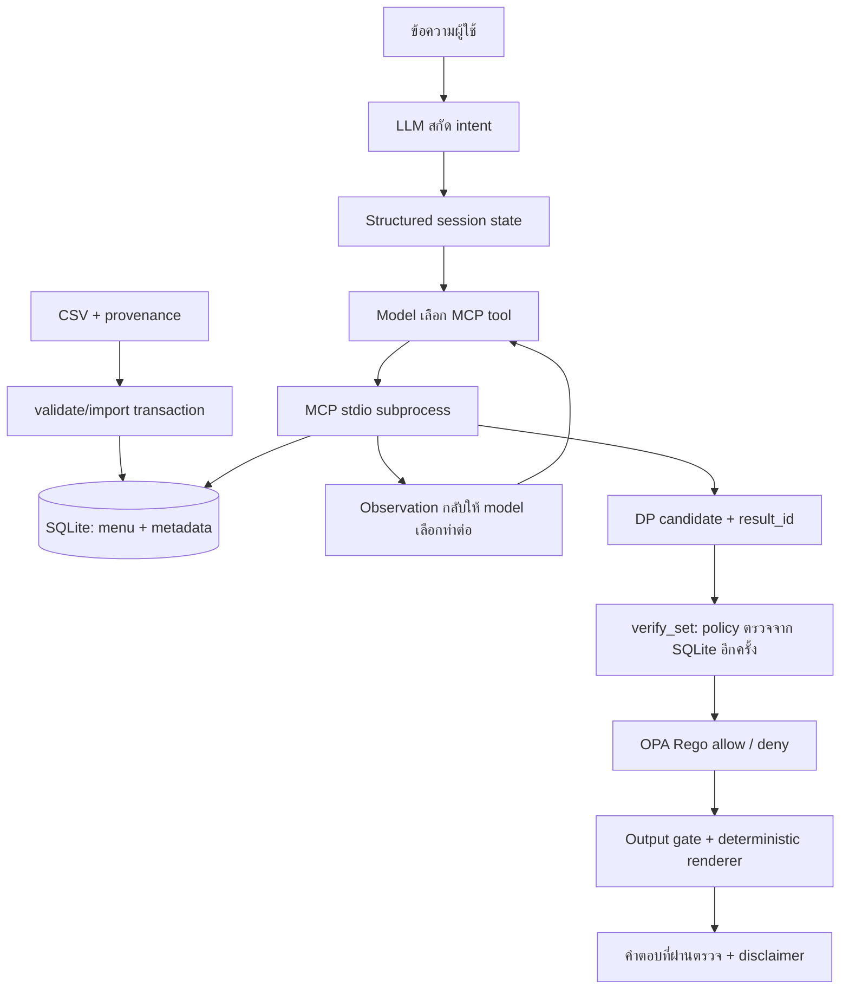

# 🍣 Shiro-Jung 4.0 — AI Agent + MCP + SQLite + OPA

ผู้ช่วยจัดชุดซูชิจาก **ฐานข้อมูล SQLite ที่นำเข้าจาก CSV จริง** มีเว็บ Streamlit และ CLI โดย Agent เลือก MCP tools อ่านผล แล้วเลือกทำต่อภายในวงจรที่จำกัดจำนวนรอบ คำแนะนำชุดอาหารจะถูกแสดงเฉพาะหลังผ่าน Python policy validator และตรวจฐานข้อมูลซ้ำก่อนตอบ

> **ข้อมูลเพื่อการศึกษา:** 42 เมนูที่แนบ (รวมน้ำเปล่า 20 บาท ราคาจากผู้ใช้) ยังไม่ได้ตรวจยืนยันราคาปัจจุบันหรือ allergen รายเมนูกับร้าน ไม่รับประกันส่วนผสมและการปนเปื้อนจริง ผู้แพ้อาหารต้องตรวจสอบกับพนักงานร้านโดยตรง

## สถานะระบบปัจจุบัน (package 4.2.0)

| ประเด็น | สถานะและหลักฐานปัจจุบัน |
|---|---|
| ไม่ชอบ/ไม่กิน/แพ้ “เนื้อ” | ให้เลือกหมู วัว ไก่ หรือสัตว์บกทั้งหมดก่อน ไม่รวมปลา/ทะเลโดยอัตโนมัติ; คงความหมาย soft/hard/allergy และจำข้อมูลมื้อเดิม; `test_round2_meat_scope.py` |
| Agent คลาสใหญ่ | แยก `intake.py`, `planning.py`, `checkout.py`; `agent.py` คุม lifecycle/routing เป็น mixins ที่ใช้ session state เดียวกัน ไม่เปลี่ยน public API |
| คะแนน Greedy สูงกว่า DP | DP 110.77 เทียบ Greedy density 117.44; DP เหมาะที่สุดตามลำดับ objective ช่วงงบก่อนคะแนน ไม่อ้างชนะทุกตัวชี้วัด |
| ใช้งบจริง | เฉลี่ย 76.25% ของงบเต็ม หรือ 95.3125% ของวงเงินอาหารเริ่มต้น 80%; ส่วนเพิ่มใช้เงินที่เหลือภายใต้งบเต็ม |
| Live LLM | ยัง `live_llm_tested=false`: ไม่มี credentials ใน environment นี้; เพิ่ม corpus 5 consumer sessions รวมเลือกเนื้อ/opt-in และตรวจ runner แบบ offline โดยไม่อ้างเป็นผล live |
| หลักฐานร้าน | allergen unknown 42/42, ราคา unverified 42/42; `scripts/catalog_audit.py` ส่งออก checklist ให้เติมหลักฐานจริง ไม่ตั้ง confirmed เอง |

หลักฐานรอบนี้เก็บแยกใน `artifacts/review-round2/` ผลรอบ 1 เก็บเป็นประวัติ ไม่แก้ผลเก่าให้ดูเหมือนผลใหม่ ดู [คำตอบข้อประเมินรอบ 2](ROUND2_RESPONSE.md) สำหรับสถานะรายข้อและงานที่ต้องใช้หลักฐานภายนอก

## โมเดลและขอบเขตรุ่นปัจจุบัน

ชื่อโครงงานคงเป็น Shiro-Jung Agent 4.0 ส่วนเอกสารนี้ตรงกับ implementation รอบแก้ไข 2, package **4.2.0** ตรวจวันที่ 22 ตุลาคม 2569 โมเดล default คือ OpenAI **`gpt-4o-mini`** ผ่าน LangChain `ChatOpenAI` ตั้ง `temperature=0`, timeout 30 วินาที และ `max_retries=1` เปลี่ยนได้ด้วย `OPENAI_MODEL` หรือ Streamlit secrets ตาม logic ใน `app.py` ให้ตรวจชื่อที่เรียกจริงจาก `agent.run_report()['model']` ไม่อนุมานจากค่า default ว่า deployment ใช้โมเดลนั้นเสมอ

หน้าเว็บใช้ `consumer_flow=True`: ข้อมูลมื้อ → สรุปยืนยัน → LLM เลือก MCP tools → ตรวจผล → เลือกอาหาร → เพิ่มรายการตามต้องการ → ยืนยันจบ คำตอบสั้น การเลือกชุด และการอ่านชื่อย่อพร้อมจำนวนใช้โค้ดโดยตรง การสร้างทางเลือกที่สองและตรวจซ้ำอยู่ใน orchestration โมเดลมีหน้าที่สกัดข้อมูลและเลือก tool ส่วน DP คำนวณชุดและ validator/OPA บังคับข้อจำกัด ไม่มีการฝึกหรือ fine-tune weights ของโมเดลในโครงการนี้

หลักฐานล่าสุดเป็น **139 regression tests, 25 Rego tests, smoke 61 ต่อโหมด และ offline gold 40/40** โดย Agent tests ใช้ scripted model ไม่ใช่ผล live OpenAI ดูขอบเขตที่ [CODE_REVIEW.md](CODE_REVIEW.md) และ [EVALUATION.md](EVALUATION.md)

## ไปต่อหลังแจ้งแพ้อาหารโดยไม่ลบการแพ้

ค่าเริ่มต้น strict ยังคงไม่แนะนำชุดสำหรับการสั่งจริงเมื่อข้อมูลส่วนผสมยังไม่ยืนยัน หลังผู้ใช้ยืนยันงบและการแพ้แล้ว หากจัดไม่ได้เพราะหลักฐานไม่พอ จะแสดงปุ่ม **ดูชุดจำลองจากข้อมูลเมนู** ผู้ใช้กดหรือพิมพ์ข้อความเดียวกันเพื่อเลือกวางแผนจากแท็กที่มีอย่างชัดเจน ไม่เปลี่ยนโหมดให้อัตโนมัติ

ระบบคงงบ คน การแพ้ ไม่กิน ชอบและไม่ชอบเดิม ใช้การกรองแท็กการแพ้ก่อน DP เช่น แพ้นมจะตัดไอศกรีม ลาเต้ และเมนูที่มี milk ตาม dataset รวมถึงเครื่องดื่มและของหวานที่เพิ่มทีหลัง ชุดที่ได้ติดป้ายทดลอง พร้อมเตือนเรื่องส่วนผสมที่ยังไม่ทราบและการปนเปื้อนข้าม ไม่รับรองว่าเป็นเมนูปลอดสารหรือปลอดภัยสำหรับผู้แพ้รุนแรง ผู้ใช้ต้องให้ร้านตรวจส่วนผสมก่อนรับประทาน การยืนยันในแอปไม่ส่งคำสั่งร้านจริง

การเลือกนี้มีผลเฉพาะมื้อ/session ของผู้ใช้ ไม่แก้ `SUSHI_DATA_MODE` ของ deployment หรือข้อมูลร้านเป็น confirmed เมื่อรีเซ็ตจะล้างความยินยอมและกลับค่า deployment เดิม สารแพ้ที่ระบบไม่รู้จักจะไม่เปิดทางเลือกนี้จนกว่าจะมี mapping ที่ถูกต้อง มี regression และ Streamlit AppTest ครอบคลุมการกดปุ่ม รักษาโหมดข้าม rerun เลือกชุด เพิ่มรายการ ยืนยันจบ และรีเซ็ต

## Dataset ตามทะเบียนสารก่อภูมิแพ้ 10 กลุ่ม

นำ CSV พร้อม mapping audit ที่ผู้ใช้ส่งวันที่22ตุลาคม2569มารวมกับชุดข้อมูลเดิม เก็บบันทึกและคำแนะนำเดิมไว้ตรวจย้อนหลัง และเพิ่มคอลัมน์กลุ่มครบ10: **ธัญพืชมีกลูเตน, สัตว์น้ำเปลือกแข็ง, ไข่, ปลา, ถั่วลิสง, ถั่วเหลือง, นมรวมแลคโตส, ถั่วเปลือกแข็ง, ซัลไฟต์ตั้งแต่10มก./กก., หอยและหมึก** ดู [`artifacts/review-round2/thai-allergen-groups.json`](artifacts/review-round2/thai-allergen-groups.json) และ `sushi_budgeteer/regulatory_allergens.py`

- คอลัมน์ `thai_allergen_<tag>` ทั้ง10กลุ่มเป็น `possible` หากแท็กเดิมรายงานไว้ หรือ `unknown` เมื่อยังไม่มีข้อมูล **ไม่มีค่า absent และช่องว่างไม่หมายถึงปลอดสาร**
- `thai_allergen_10_unverified` เป็นชื่อกลุ่มไทยที่คำนวณจาก `allergen_tags`; งา/หมู/วัว/ไก่/seafood/echinoderm เป็นข้อจำกัดเพิ่มเติมนอกทะเบียน10กลุ่ม ไม่ตัดออกจากระบบเพียงเพราะไม่อยู่ในทะเบียน
- เก็บ `mapping_audit_note` และ `recommended_thai_allergen_10_unverified` จากไฟล์ผู้ใช้เพื่อ audit เท่านั้น ไม่ใช้คำแนะนำจากชื่อเมนูลบแท็กซอสหรือเครื่องปรุง เช่น soy/gluten ของปลาไหล และ soy ของวาราบิโมจิ
- เพิ่ม milk แบบ possible ให้ S014 ที่ชื่อระบุเนย และ fish ให้ R001 ที่ระบุปูอัด โดยยังคงแท็กเดิม ทั้งสองกรณี **ยังไม่ยืนยันสูตรจากร้าน**
- อ้างประกาศกระทรวงสาธารณสุข450พ.ศ.2567ข้อ5(6)ตามไฟล์ผู้ใช้ เป็นเกณฑ์จัดกลุ่มฉลากอาหารบรรจุภัณฑ์ ไม่ใช่หลักฐานส่วนผสมรายเมนูของร้าน
- ทะเบียนสำหรับอาหารบรรจุภัณฑ์ไม่ใช่หลักฐานส่วนผสมรายเมนูของร้าน โดยเฉพาะซัลไฟต์ยังไม่มีค่าความเข้มข้น ข้อมูลทุกเมนูจึงยังมี `allergen_status=unknown` และ strict ไม่ลดมาตรฐานเอง

## เงื่อนไขการจัดชุดปัจจุบันสำหรับการประเมิน

หน้าเว็บใช้ **ประมาณ 80% ของงบที่ผู้ใช้แจ้ง** เพื่อเหลืออย่างน้อย 20% สำหรับการเพิ่มเครื่องดื่ม ของหวาน หรืออาหารภายหลัง ไม่พยายามใช้เงินให้หมดงบเดิม

| ตัวอย่างงบ 3,000 บาท | เงื่อนไข |
|---|---|
| วงเงินจัดชุด | ไม่เกิน 2,400 บาท คำนวณเป็นสตางค์และปัดลง |
| เงินเผื่อเปลี่ยนใจ | อย่างน้อย 600 บาท; หากจัดชุดต่ำกว่าเป้า จะเหลือมากกว่านี้ |
| ช่วงเป้าหมาย | พยายามจัดในช่วง 95–100% ของวงเงินจัดชุด หรือ 2,280–2,400 บาท (76–80% ของงบเดิม) |
| น้ำ/ขนมที่เลือกแล้ว | แบบรวมในงบ จะหักออกจาก 2,400 บาทก่อนจัดอาหาร ไม่บวกเกินวงเงินนี้ |
| ความหลากหลาย | จานแรกของแต่ละเมนูได้คะแนนเต็ม จานที่ 2 ได้ 50% และจานที่ 3 ได้ 25% เพื่อสนับสนุนเมนูไม่ซ้ำ |
| จำนวนรายการ | หากผู้ใช้ไม่กำหนด ใช้ขอบเขตสูงสุด 60 รายการแทนเพดานเดิม 20; หากระบุเอง เช่น ไม่เกิน 20 รายการ จะคงตามนั้น |
| เมนูซ้ำ | ไม่เกิน 3 จานต่ออาหารหนึ่งเมนู; จำนวนรายการรวมเครื่องดื่มและของหวานด้วย |

หากราคาและข้อจำกัดทำให้เข้าไม่ถึงช่วงเป้าหมาย ระบบเลือกยอดใกล้วงเงินจัดชุดที่สุดที่ทำได้ ไม่เกินวงเงิน ไม่เพิ่มเมนูที่แพ้หรือขัดข้อห้ามเพื่อเติมยอด แสดงยอดเงินจริงและเงินที่เหลือ แต่ไม่แสดงข้อความเรื่องเพดานจำนวนรายการหรือข้อจำกัดเมนูซ้ำบนหน้าแชต รายละเอียดเหล่านี้เก็บไว้หลังบ้าน ไม่มีการรับรองว่าจะใช้ได้ครบ 80% ทุกกรณี ความหลากหลายเป็นแรงจูงใจในการให้คะแนน ไม่ใช่จำนวนเมนูขั้นต่ำที่รับประกัน

เงื่อนไขการแพ้มาก่อนราคาเสมอ: “ไม่ชอบ” เป็นความชอบด้านรสชาติ ไม่ใช่การแพ้ โหมด strict จะปิดกั้นเมนูที่ข้อมูลส่วนผสมยังไม่ยืนยัน ผู้ใช้ยืนยันการแพ้ในสรุปเดียวก่อนจัดชุด การยืนยันนี้ยืนยันความต้องการของผู้ใช้ **ไม่ได้ยืนยันส่วนผสมแทนร้าน** และผู้แพ้ต้องตรวจสอบกับพนักงานก่อนรับประทาน

บทสนทนาเริ่มจากข้อมูลมื้อ → ยืนยันข้อมูล → เลือกอาหารจากสูงสุด 2 ชุด → สรุปอาหารทันที → หากต้องการเพิ่ม พิมพ์ “เครื่องดื่ม” หรือ “ของหวาน” เพื่อดูรายการ/ราคา → พิมพ์ชื่อพร้อมจำนวน → สรุปรวมอาหารเดิมกับรายการเพิ่มทันที → ยืนยันรายการทั้งหมด ก่อนยืนยันชุดสุดท้ายสามารถปรับเมนูต่อโดยใช้ข้อมูลแพ้/ชอบ/ไม่ชอบเดิม หลังยืนยันจะแสดงคำอวยพรปิดท้ายและปุ่มรีเซ็ตคำถามเพื่อเริ่มใหม่ การเลือกชุดยังไม่ใช่การส่งคำสั่งซื้อหรือชำระเงิน

**ขอบเขตจำนวนใน checkout:** การจัดอาหารยังมีขอบเขต 60 รายการและซ้ำไม่เกิน 3 จานต่อเมนู หากไม่ได้กำหนดจำนวนสูงสุดเอง เมื่อเพิ่มภายหลังจะตรวจแยกอาหารไม่เกิน 60 เครื่องดื่มไม่เกิน 60 และของหวานไม่เกิน 60 รวมไม่เกิน 180 รายการ เพื่อไม่ให้เพดานอาหารเดิมปฏิเสธการเพิ่มน้ำหนึ่งแก้ว ถ้าผู้ใช้กำหนดจำนวนรวมสูงสุดเองจะยังรักษาค่านั้น ไม่ขยายให้เอง การขยายขอบเขตนี้ใช้เฉพาะ checkout ที่ตรวจตะกร้าฝั่ง backend; การจัดอาหารและ direct tool เดิมยังจำกัด 60 ตามเดิม ทุกกรณีตรวจยอดรวมและการแพ้เหมือนเดิม

เมื่อเข้าสู่ขั้นตอนสรุปสุดท้ายบนเว็บ อาหารที่เลือกจะถูกคงไว้ เครื่องดื่ม/ของหวานที่เลือกภายหลังใช้เงินส่วนที่เหลือได้ โดยยอดรวมทุกหมวดต้องไม่เกิน **งบเดิมทั้งหมด** ไม่จำกัดไว้ที่ 80% อีกต่อไป และไม่เปลี่ยนอาหารเองเพื่อชดเชยค่าเพิ่ม หากเกินงบ ผู้ใช้ต้องลดจำนวนหรือเปลี่ยนรายการก่อนยืนยัน กรณีเรียก direct tools แบบเดิมยังรองรับการคิดเครื่องดื่มแยกนอกงบ แต่ checkout บนเว็บสรุปทุกหมวดรวมกัน ภาษีและ service charge ยังไม่ได้จำลอง

## ไฟล์พร้อมใช้และขอบเขต

- `app.py`: เว็บแชต แยก Agent ต่อ Streamlit session ไม่มี cache แชร์บทสนทนา
- `sushi_budgeteer/agent.py`: lifecycle, session state และ message routing
- `sushi_budgeteer/intake.py`: สกัดและยืนยันข้อมูล รวมการเลือกชนิดเนื้อ
- `sushi_budgeteer/planning.py`: model → MCP tool → observation loop และ output gate
- `sushi_budgeteer/checkout.py`: เลือกอาหาร เพิ่มน้ำ/ขนม และตรวจยอดก่อนยืนยัน
- `mcp_server.py`: MCP stdio server อ่าน SQLite; เปิด subprocess แยกต่อ client/turn
- `sushi_budgeteer/database.py`: validate/import CSV และอ่านฐานข้อมูล
- `sushi_budgeteer/optimizer.py`: exact bounded DP ด้วยมิติจำนวนและหน่วยเงินสตางค์
- `sushi_budgeteer/policy.py`: ตรวจงบ จำนวน allergen ข้อห้าม catalog revision และราคาใหม่จาก DB
- `sushi_budgeteer/service.py`: เก็บ candidate พร้อม constraint snapshot ใน server ด้วย result ID
- `sushiro_menu_dataset.csv`: ข้อมูลตั้งต้นและ provenance ไม่ใช่ข้อมูลราคาสดจากเว็บ
- `data/menu.sqlite3`: ฐานข้อมูลที่สร้างแล้วในชุด ZIP; สร้างใหม่จาก CSV ได้
- `tests/`, `scripts/`: regression tests, setup, benchmark และ demo traces
- `requirements.lock`: dependency versions พร้อม SHA256 hashes สำหรับ Python 3.12
- `mcp-config.example.json`: ตัวอย่างเชื่อม MCP client ภายนอก

**สิ่งที่ต้องเตรียมเอง:** Python 3.12, Internet สำหรับติดตั้ง dependencies และ OpenAI API key สำหรับแชตจริง ไม่มี key ก็รัน database/MCP/tests/benchmark ได้ มี OPA 1.0.1 และ Rego policy ใช้งานจริง แต่ไม่อ้างว่าได้คะแนนพิเศษหรือผ่านการทดสอบ LLM จริงแล้ว

## เริ่มเร็วที่สุด (ทุกระบบปฏิบัติการ)

หลังติดตั้ง dependencies ตามหัวข้อถัดไป ใช้คำสั่งเดียวรันหลักฐานทั้งหมดแล้วสร้างรายงาน HTML ใหม่ (ไม่ต้องใช้ bash):

```bash
python scripts/collect_evidence.py --offline   # ไม่เรียก LLM; import CSV แบบ replace catalog ด้วย
python scripts/collect_evidence.py             # + live smoke 3 กรณี เมื่อมี key ใน .env
python scripts/collect_evidence.py --full      # + live ทุกกรณี + multi-turn 3 sessions
```

สคริปต์บังคับ UTF-8 ให้ subprocess เพื่อให้ข้อความไทยไม่พังบน Windows และถ้าไม่มี key จะบันทึกว่า skipped ไม่ใช้ผลจำลองแทน

## ติดตั้งและเริ่มใช้งาน

Linux/macOS:

```bash
cd Shiro-Jung-Agent-v4
python3.12 -m venv .venv
source .venv/bin/activate
python -m pip install --require-hashes -r requirements.lock
python scripts/install_opa.py
python -m sushi_budgeteer.database import
python scripts/run_checks.py
cp .env.example .env
# เปิด .env ด้วย editor แล้วตั้ง OPENAI_API_KEY โดยไม่แชร์หรือ commit ค่า
python -m streamlit run app.py --server.headless true --browser.gatherUsageStats false
```

Windows PowerShell:

```powershell
cd Shiro-Jung-Agent-v4
py -3.12 -m venv .venv
.\.venv\Scripts\python.exe -m pip install --require-hashes -r requirements.lock
.\.venv\Scripts\python.exe scripts/install_opa.py
.\.venv\Scripts\python.exe -m sushi_budgeteer.database import
.\.venv\Scripts\python.exe scripts/run_checks.py
Copy-Item .env.example .env
# ตั้ง key ใน .env แล้วเริ่มเว็บ
.\.venv\Scripts\python.exe -m streamlit run app.py --server.headless true --browser.gatherUsageStats false
```

ทดสอบการติดตั้งจริงบน Linux/Python 3.12.14; คำสั่ง Windows/macOS จัดไว้เป็นแนวทางและยังไม่ได้ทดสอบบนเครื่องเหล่านั้น หากต้องการ terminal chat ใช้ `python -m sushi_budgeteer` พิมพ์ `/exit` จบ; CLI เป็น legacy flow และ `/reset` ปัจจุบันล้างเฉพาะ state ไม่ได้รีเซ็ต workflow ทั้งหมดเหมือนปุ่มหน้าเว็บ ส่วน `llm_qa.py` เป็นตัวอย่างถาม LLM ตรง ๆ ไม่ใช่ Agent จัดชุดอาหาร

`bash scripts/setup.sh` รวมขั้นตอนสร้าง venv/ติดตั้ง/import/test สำหรับ Linux/macOS; `bash scripts/start.sh` เริ่มเว็บหลัง setup คำสั่ง import จะ **แทน catalog เดิม** ด้วย CSV ให้สำรองฐานข้อมูลที่แก้เองก่อน รัน setup ซ้ำจึงเหมาะเมื่อ CSV เป็น source of truth

ใน cloud ให้ทำงานจากโฟลเดอร์ `Shiro-Jung-Agent-v4` ของ checkout ที่ใช้งานจริง และ activate `.venv` ตามขั้นตอนข้างต้น ไม่ใช้ absolute path ของเครื่องอื่น

## Configuration

| ตัวแปร | ค่าเริ่มต้น/หน้าที่ |
|---|---|
| `OPENAI_API_KEY` | key สำหรับ LLM; ไม่อยู่ใน ZIP |
| `SUSHI_OPENAI_API_KEY` | ชื่อสำรองสำหรับ cloud ที่สงวนชื่อ `OPENAI_`; Agent รองรับโดยตรง |
| `OPENAI_MODEL` | `gpt-4o-mini` |
| `SUSHI_DATA_MODE` | default `strict`; `simulation` สำหรับการทดลอง; per-meal opt-in บนเว็บไม่เปลี่ยน environment นี้ |
| `SUSHI_DB_PATH` | default `data/menu.sqlite3`; แนะนำ absolute path เมื่อกำหนดเอง |
| `SUSHI_MENU_CSV_PATH` | ใช้เป็นไฟล์ตั้งต้นเมื่อ DB ยังไม่มี |
| `SUSHI_OPA_BINARY` | default `tools/opa/opa` หรือ `opa.exe`; หาไม่พบ/timeout จะไม่อนุญาตคำแนะนำ |

ตัวอย่าง `.env` ไม่มี key จริงและ `.gitignore` กัน `.env` แล้ว ห้ามใส่ key ใน CSV, database, trace หรือ MCP config Python dependencies ใช้ PyPI ส่วน model เรียก `api.openai.com` ซึ่งอาจมีค่าใช้จ่าย

โหมดความปลอดภัยตั้งค่าที่ backend ผ่าน `SUSHI_DATA_MODE` ไม่แสดงตัวเลือกโหมดแยกบนหน้าผู้บริโภค:

- **strict (default):** เมื่อระบุ allergen จะเลือกเฉพาะเมนูที่ `allergen_status=confirmed` และไม่ชน tag; dataset ที่แนบเป็น unknown ทั้งหมด จึงจะปิดกั้นการจัดชุดสำหรับผู้แพ้จนมีหลักฐานรายเมนู
- **simulation:** ทดลองใช้ tags จำลองใน CSV เพื่อทดสอบ/นำเสนอ ทุกคำตอบยังแสดงคำเตือน ไม่ใช่โหมดรับรองความปลอดภัย

## CSV กลายเป็นฐานข้อมูลและ MCP ดึงข้อมูลอย่างไร



```bash
python -m sushi_budgeteer.database import --csv sushiro_menu_dataset.csv
python -m sushi_budgeteer.database status
python mcp_client_demo.py
```

Importer ตรวจคอลัมน์ที่จำเป็น ID ไม่ซ้ำ ราคาไม่ติดลบ/ทศนิยมไม่เกิน 2 ตำแหน่ง และสถานะ provenance ก่อนเขียนแบบ transaction หาก CSV ไม่ผ่าน DB เดิมยังอยู่ หลัง import tools จะอ่าน `SELECT` จาก SQLite ทุกครั้ง ไม่อ่านค่าจากความจำ LLM และไม่ใช้ process-global menu cache

**CSV เป็นไฟล์นำเข้า ส่วน SQLite เป็น runtime database:** แก้ CSV แล้วต้อง import อีกครั้ง การแก้ SQLite โดยตรงมีผลต่อการค้นหาครั้งถัดไป แต่ไม่ sync กลับ CSV อัตโนมัติ เมื่อข้อมูลเปลี่ยนระหว่าง build กับ verify จะปฏิเสธ candidate revision เก่า

ดู schema และข้อกำหนดหลักฐานใน [DATA_DICTIONARY.md](DATA_DICTIONARY.md) ไม่ควรเปลี่ยน `unknown` เป็น `confirmed` เพียงเพราะพบชื่อวัตถุดิบในชื่อเมนู

## MCP tools ที่ Agent ใช้จริง

| Tool | หน้าที่ |
|---|---|
| `database_status` | อ่านจำนวนเมนู revision และสถานะข้อมูลจาก SQLite |
| `search_menu` | ค้นชื่อ/หมวด/เพดานราคา คืนข้อมูลจาก DB |
| `get_menu_item` | อ่านรายละเอียด item ID รวม provenance |
| `filter_menu` | ดูผลกรอง allergens และ dislikes; ข้อห้าม dietary ใช้ใน builder/validator |
| `build_set` | จัดชุดด้วย DP ตามข้อจำกัด คืน candidate หรือ requires_clarification |
| `verify_set` | รับ result ID ที่ server สร้าง ตรวจ catalog/ราคา/ยอด/ข้อจำกัดใหม่ |
| `clarify` | สร้างคำถามช่องข้อมูลที่ขาด |
| `alternative_set` | Server tool ที่ orchestration เรียกเพื่อสร้างชุดที่สอง; ไม่อยู่ใน schemas ที่ให้ LLM เลือก |

Resources: `sushiro://menu/catalog`, `sushiro://menu/status`; prompt: `budget_optimizer`

การวางแผนและสร้างทางเลือกเรียก tools ผ่าน MCP จริง ส่วนการเลือกชุดและ checkout ตรวจด้วย validator ฝั่ง Agent อีกครั้ง ผลลัพธ์แต่ละชุดมี UUID และ trusted constraint snapshot ฝั่ง server; client ส่งยอด/รายการมาอ้างว่าผ่านเองไม่ได้ result ID ใช้ได้ใน subprocess ที่สร้างมันและหมดอายุเมื่อจบ turn

สำหรับ external MCP client ให้แทน absolute paths ใน `mcp-config.example.json` ตามเครื่อง เลือก `strict` เป็นค่าเริ่มต้น แล้วให้ client เปิด `python mcp_server.py` แบบ stdio ไม่ต้องเปิด server ทิ้งไว้อีกอัน ไม่มี SSE/network endpoint ที่เปิดให้เข้าถึงโดยไม่มี authentication Client ภายนอกต้องบังคับ verify เองด้วย; output gate ที่แถมมาครอบคลุม Agent ของโครงการนี้

## ทำไมเป็น Agent และมีการตัดสินใจอะไร

ภายใน `BudgeteerAgent._run()` โมเดลเลือก tool จาก schemas ของ MCP ตามเป้าหมายและ observation ที่ได้กลับมา แล้วเลือกทำต่อหรือจบ เช่น ค้นเมนูก่อนจัดชุด ขอข้อมูลเพิ่ม หรืออ่านข้อผิดพลาดหลังจัดไม่ได้ ไม่ใช่ pipeline ที่ Python เรียก search/build ทุกตัวตามลำดับตายตัว

**ข้อกำหนดที่ Python บังคับ:** build ต้องมีข้อมูลครบ, ใช้ constraints จาก state ที่สกัดจากผู้ใช้แทน argument ที่ model อาจเปลี่ยนเอง, verify ต้องอ้าง candidate ของ turn นี้ และต้อง verify ซ้ำตอนจะส่งผลออก หากไม่ผ่านจะไม่แสดงชุดอาหาร ไม่ปล่อยข้อความคาดเดาของ LLM เป็นคำแนะนำ และไม่ stream ข้อความก่อนตรวจเสร็จ

วงจรจำกัด 10 model rounds และไม่เกิน 8 tool calls ต่อ round มี timeout ต่อการเรียก MCP และขอบเขต DP หากเกิดข้อผิดพลาดจะหยุด/ถามเพิ่ม การสกัดภาษาธรรมชาติยังขึ้นกับความถูกต้องของ LLM จึงสรุปข้อมูลและให้ผู้ใช้ยืนยันก่อนจัดชุด และยังต้องทดสอบ provider จริงก่อนใช้จริง

## เลือกชนิดเนื้อสัตว์บกโดยไม่เริ่มมื้อใหม่

เมื่อพบคำกว้าง “ไม่ชอบเนื้อ / ไม่กินเนื้อ / แพ้เนื้อ” ระบบถามเลือก **หมู / เนื้อวัว / ไก่ / สัตว์บกทั้งหมด** เพียงขั้นเดียวก่อนสรุปยืนยัน โดยเก็บงบ จำนวนคน และเงื่อนไขเดิมไว้ คำที่ระบุชนิดอยู่แล้ว เช่น “ไม่กินเนื้อวัว” ไม่ต้องถามชนิดซ้ำ “ไม่แพ้เนื้อ” ไม่เปิดคำถามการแพ้

- ไม่ชอบ: ลดคะแนนเฉพาะชนิดที่เลือก ไม่ตัดเป็น hard constraint หรือสร้าง allergy
- ไม่กิน: ตัดเมนูตาม dietary tags ของชนิดที่เลือก ตรวจซ้ำตอน build/verify/checkout
- แพ้: เพิ่มข้อจำกัดการแพ้ ไม่ลบการแพ้เดิม; สำหรับหมู/วัว/ไก่ตรวจทั้ง `allergen_tags` และแท็กวัตถุดิบเนื้อสัตว์ใน `dietary_tags` พร้อมกฎ Rego แยกต่างหาก Strict/opt-in และคำเตือนยังคงเดิม

ปลาและอาหารทะเลไม่ถูกตัดเพราะการเลือกเนื้อสัตว์บก แต่ยังรักษาการแพ้/ข้อห้ามเดิม ผู้ที่แพ้ปลาอยู่แล้วจึงยังถูกกรองปลา ไม่มีเมนู beef ใน seed catalog ปัจจุบัน การไม่กินวัวอย่างเดียวอาจไม่ตัดรายการใด ส่วนการงดสัตว์บกทั้งหมดจะตัด F001 หมูและ F002 ไก่ตามแท็กที่มี Direct builder รองรับ alias “เนื้อ” เป็นกลุ่ม pork/beef/chicken; หน้าเว็บจะถามชนิดก่อนเพื่อไม่เดาความหมาย

## เงื่อนไขและตัวอย่างการใช้งาน

หน้าเว็บต้องมีงบและจำนวนคน แล้วแสดงสรุปการแพ้/ข้อห้าม/ชอบ/ไม่ชอบให้ยืนยันครั้งเดียว ถ้ายังไม่เลือกน้ำหรือขนมจะไม่เพิ่มให้ ผู้ใช้เพิ่มภายหลังด้วยชื่อและจำนวนได้

```text
ผู้ใช้: งบ 1,000 บาท 2 คน ชอบแซลมอน ไม่ชอบปลาหมึก ไม่มีแพ้
ระบบ: สรุปข้อมูลมื้อให้ตรวจและยืนยัน
ผู้ใช้: ยืนยันว่าไม่แพ้และจัดชุด
ระบบ: [LLM เลือก tools → build_set → verify_set → ตรวจซ้ำ → แสดง ≤ 2 ชุด]
ผู้ใช้: เลือกชุด 1
ระบบ: สรุปอาหารที่เลือก ยอดรวม และเงินเหลือ
ผู้ใช้: เครื่องดื่ม
ระบบ: รายการเครื่องดื่มและราคา
ผู้ใช้: น้ำส้ม 2 ชาเขียว 1
ระบบ: สรุปอาหารเดิมรวมเครื่องดื่มและเงินเหลือ
ผู้ใช้: ของหวาน
ระบบ: รายการของหวานและราคา
ผู้ใช้: วาราบี 1 ชาเขียว 1
ระบบ: เพิ่มโมจิ 1 และไอศกรีมชาเขียว 1 แล้วสรุปรวมใหม่
ผู้ใช้: ยืนยันรายการทั้งหมด
ระบบ: ตรวจยอด/ข้อจำกัดอีกครั้ง แล้วปิดบทสนทนาพร้อมปุ่มรีเซ็ต
```

ตัวอย่างเป็น flow ที่ออกแบบไว้ ไม่ใช่ transcript ของ OpenAI ที่ผ่านการทดสอบจริง ถ้าระบุการแพ้และ strict จัดไม่ได้เพราะหลักฐานยังไม่พอ ให้ผู้ใช้เลือก **ดูชุดจำลองจากข้อมูลเมนู** เพื่อวางแผนโดยกรองแท็กแพ้เดิม ระบบไม่ลบการแพ้ ไม่เปลี่ยนข้อมูลร้านเป็น confirmed และยังต้องให้ร้านตรวจส่วนผสมก่อนรับประทาน

CLI (`python -m sushi_budgeteer`) และ single-turn live evaluator ยังใช้ legacy readiness ซึ่งอาจถามชื่อ/จำนวนเครื่องดื่ม โหมดงบ และของหวานทีละช่อง ตัวอย่างหน้าเว็บข้างต้นไม่ใช่คำอธิบายของ CLI ดูข้อจำกัด reset ใน CODE_REVIEW

## Optimization และ verification

เป้าหมายจัดชุดใช้ **วงเงิน 80% ของงบเดิม** (`spend_ratio=0.8` จากหน้าเว็บ) แล้วหักเครื่องดื่ม/ของหวานที่รวมในงบออกก่อน ภายในงบอาหารที่เหลือ เลือกชุดในช่วง 95–100% ของงบอาหารโดยเรียงคะแนนความชอบหลังลดคะแนนเมนูซ้ำก่อน แล้วใช้ยอดเงินจริงเป็นตัวตัดสินเมื่อคะแนนเท่ากัน หากไม่มีชุดในช่วงนั้น ให้เรียงยอดใกล้งบอาหารที่สุดก่อนคะแนน ทั้งหมดอยู่ภายใต้ช่วงจำนวนรายการและอาหารซ้ำไม่เกิน 3 จานต่อเมนู ใช้ state `(count, cost_satang)` และ immutable backtracking จึงไม่ทิ้งทางเลือกเพราะจำนวนจานต่างกัน มี state limit 250,000 เพื่อให้การทำงานจำกัดทรัพยากร หากเกิน limit จะรายงานให้ลดขนาด ไม่เปลี่ยนไปสุ่มแนะนำ

```text
score = preference + price_score + category_bonus - dislike_penalty (ต่ำสุด 0)
preference: 2.5 ต่อ preferred keyword ที่ตรง สูงสุด 5
price_score: ราคา 35–80 = 3, ราคาอื่น <=100 = 2, ราคา >100 = 1
category_weight (legacy, ไม่ใช่ category coverage): ไม่ใช่หมวดปลาดิบ = 2, ปลาดิบ = 0
penalty: ตรง dislike = 3
```

เครื่องดื่ม/ของหวานที่ระบุก่อน build จัดเป็น fixed allocation และหักวงเงินเมื่อเลือกแบบรวม ส่วนที่เพิ่มหลังเลือกอาหารตรวจใน checkout กับงบเต็ม ความหลากหลายสนับสนุนผ่านคะแนนส่วนเพิ่มที่ลดลงตามจำนวนจานซ้ำ (1, 0.5, 0.25 เท่าของคะแนนพื้นฐาน) และรายงานจำนวนเมนูไม่ซ้ำ ไม่ใช่การบังคับครบทุกหมวด ไม่ใช่คะแนนโภชนาการหรือคุณภาพจริง

Validator คำนวณราคา × จำนวนจาก catalog จริง ตรวจ ID, quantity, ยอดรวม, งบตาม mode, จำนวนขั้นต่ำ/สูงสุด, อาหารอย่างน้อยหนึ่งจาน, repeat cap, allergen, hard exclusions, only-food constraint และ catalog revision ผลที่ไม่ผ่านไม่ถูกนำไปแสดงเป็นคำแนะนำ จำนวนเครื่องดื่ม/ของหวานที่ขอจะถูกตรวจด้วย

การเรียก library `dp_knapsack` แบบเดิมยังมี `objective="score"` เป็นค่าเริ่มต้นเพื่อคง baseline สำหรับการวิเคราะห์ ส่วน `build_optimal_set` ใช้ `objective="budget", diversity=True` และการจัดอาหารเริ่มต้นบนเว็บส่ง `spend_ratio=0.8`; checkout ตรวจส่วนเพิ่มด้วยงบเต็ม MCP/direct tools มีค่าเริ่มต้น `spend_ratio=1.0` สำหรับผู้เรียกเดิม จึงต้องระบุ 0.8 เมื่อต้องการจำลองเงื่อนไขเว็บ

Benchmark ล่าสุดใช้ค่าเดียวกับ production: **objective=budget, diversity=true, spend_ratio=0.8, max_items=60, repeat_cap=3** เปรียบเทียบ DP, greedy density, greedy score และ Random บน safe pool เดียวกัน 12 สถานการณ์ (งบ 300/1,000/3,000/6,000 × 3 เงื่อนไข) และ Random 100 seeds ต่อสถานการณ์ รวม 1,200 runs รายงานใน `artifacts/review-round2/benchmark-production.json`

DP ใช้งบเฉลี่ย **76.25% ของงบเต็ม / 95.3125% ของวงเงินอาหาร**, เมนูไม่ซ้ำเฉลี่ย 16.5 และ 7.42 หมวด คะแนนลดซ้ำเฉลี่ย 110.77; greedy density ได้คะแนน 117.44 และ 7.92 หมวด แต่ใช้งบเต็ม 72.06% จึง **ไม่อ้างว่า DP ชนะทุกตัวชี้วัด** ตรวจ dominance ตาม objective แบบ lexicographic เดียวกับ production ไม่ใช่ raw score; ไม่มี dominance failure และ feasibility failure ในชุดนี้ การใช้เงินอาจต่ำกว่าเป้าเมื่อเพดานจำนวน/ข้อจำกัดทำให้ทำไม่ได้ เวลา benchmark เป็น algorithm time ไม่ใช่เวลาตอบแชต

`artifacts/benchmark.json` และตัวเลข DP 33.333 / Random 21.4825 เป็น **baseline รุ่นก่อนแบบ score-first** เท่านั้น ไม่ใช่ผล production รอบนี้ และไม่ใช่หลักฐานคุณภาพ LLM ความพึงพอใจหรือข้อมูลร้าน

## ทดสอบและ artifacts

```bash
python scripts/run_checks.py --output-dir artifacts/review-round2
python mcp_client_demo.py
python scripts/benchmark.py --output artifacts/review-round2/benchmark-production.json
python scripts/capture_demo.py
python scripts/evaluate.py --mode offline --output artifacts/review-round2/offline-evaluation.json
python scripts/evaluate.py --mode live --limit 3
python scripts/live_sessions.py --scenarios evaluation/round2_sessions.json --output artifacts/review-round2/live-status.json
python scripts/build_report.py
```

ผลตรวจในชุดนี้:

- Regression/integration **139 tests** รวม DP เทียบ exhaustive search 35 fixtures, ทศนิยม, tampering, session isolation, unknown allergen, strict/simulation, DB เปลี่ยน, Agent gate และ Streamlit page
- OPA/Rego **25 tests** ตรวจ allow/deny แยกจาก Python
- Evaluation **40 กรณี** ผ่าน MCP/SQLite/OPA จริง โดยไม่เรียก LLM; แยกจาก regression tests
- Smoke **61 checks ต่อโหมด** ผ่านทั้ง strict และ simulation
- MCP ทดสอบ subprocess จริง และเปลี่ยนราคาใน SQLite แล้วอ่านผ่าน MCP เพื่อพิสูจน์การดึงข้อมูลจริง
- ติดตั้งจาก lockfile พร้อมตรวจ hashes ใน venv ใหม่บน Linux/Python 3.12 ผ่าน
- Agent tests ใช้ **scripted fake model + MCP/SQLite จริง** ยังไม่ได้เรียก OpenAI จริงเพราะไม่มี API key

Artifacts ล่าสุด: `artifacts/review-round2/validation-report.json`, `artifacts/review-round2/opa-tests.json`, smoke logs ทั้งสองโหมด, `artifacts/review-round2/offline-evaluation.json`, `artifacts/review-round2/live-status.json`, `artifacts/review-round2/scripted-consumer-trace.json`, `artifacts/review-round2/benchmark-production.json` และ HTML ที่สร้างด้วย `scripts/build_report.py` ส่วน snapshot รอบ1และชื่อเดิมนอกกลุ่มนี้เป็นหลักฐานรุ่นก่อน ดูขอบเขตและวันรันใน [EVALUATION.md](EVALUATION.md)

`python scripts/collect_evidence.py --offline` เป็นคำสั่งรวมที่ **import CSV แบบ replace catalog ด้วย** หากมีข้อมูลร้านที่แก้ใน SQLite ให้สำรองก่อน หรือใช้คำสั่งแยกด้านบนเพื่อไม่ replace ข้อมูล การสร้าง report ไม่ได้รันทดสอบใหม่

Trace ระบุ model source, session/turn ID, tools ที่เลือก, arguments, observation status, OPA decision, latency และ token counts จาก provider โดยไม่บันทึก prompt/chain-of-thought/API key ผล `scripted` ไม่ใช่หลักฐาน LLM จริง หาก provider ไม่รายงาน usage จะระบุว่าไม่ครบและไม่ตีค่าใช้จ่ายเป็นศูนย์ Cost ใน live evaluation คำนวณเมื่อผู้ใช้ระบุ rate ที่ต้องการเองเท่านั้น เป็นประมาณการที่ยังไม่แยก cached token discounts

กฎสัดส่วน 80% เป็นการทำงานหลังบ้าน: หน้าแชตและสรุปยืนยันไม่แสดงข้อความ “จัดชุดใกล้ 80%” หรือเปอร์เซ็นต์การใช้งบ แสดงเฉพาะงบ ยอดใช้จริง และยอดคงเหลือ เอกสารนี้ยังอธิบายสูตรเพื่อการตรวจประเมิน

**การอ่านคำสั่งสั้น:** ไม่ต้องใส่หน่วย เช่น `น้ำส้ม 2` เท่ากับ `น้ำส้ม 2 แก้ว`; `โมจิ 2` เท่ากับ `โมจิ 2 ชิ้น` รองรับชื่อย่อของหวาน เช่น `ชีสเค้ก 1 วาราบิ 1` หมายถึงทาร์ตชีสเค้ก 1 ชิ้น และวาราบิโมจิ 1 ชิ้น รวม 100 บาท แล้วสรุปรวมกับอาหารที่เลือกไว้ทันที พิมพ์หลายรายการพร้อมกันได้ เช่น `น้ำส้ม 2 ชาเขียว 1 น้ำเปล่า 2` รองรับตัวเลขไทยและรูป Unicode ของสระไทย โดยใช้ชื่อ/ราคาใน catalog จริง ไม่เรียก LLM เพื่ออ่านจำนวนเหล่านี้ ชื่อ “ชาเขียว” อิงหมวดเมนูล่าสุด: ในหมวดเครื่องดื่มหมายถึงชาเขียวร้อน ในหมวดของหวานหมายถึงชาเขียวไอศกรีม รองรับทั้ง “วาราบิ” และ “วาราบี” เช่น `วาราบี 1 ชาเขียว 1` หลังเปิดของหวาน รวม 80 บาท

รองรับคำสะกด `ไอศครีม`, `ไอครีม`, `ไอติม` เป็น `ไอศกรีม` แต่ catalog มีสองชนิด จึงจำจำนวนไว้และถามชนิดเพียงครั้งเดียว (ชาเขียวไอศกรีมหรือไอศกรีมซอร์เบต์องุ่น) ผู้ใช้ตอบชื่อสั้นหรือเลขชนิด ไม่ต้องตอบจำนวนใหม่ รายการอื่นในข้อความเดียวกันจะเก็บรอไว้และรวมยอดเมื่อระบุชนิดครบ การยืนยันสุดท้ายปิดไว้ระหว่างที่ชนิดยังไม่ชัดเจน เพื่อไม่ส่งรายการที่เดาเอง

เมื่อพิมพ์ “เมนูของหวาน” หรือ “เมนูน้ำ” ระบบอ่านรายการและราคาจาก catalog โดยตรง เป็นข้อความในแชต ไม่แสดงฟอร์ม ปุ่มรับ/ไม่รับ หรือคำถามข้ามไปหมวดอื่น ผู้ใช้พิมพ์ชื่อพร้อมจำนวนได้เลย เช่น `น้ำส้ม 1 แก้ว` หรือ `โมจิ 1 พุดดิ้ง 2` แล้วได้สรุปยอดทันที รายการต่างเมนูสะสมในตะกร้า ส่วนการระบุเมนูเดิมอีกครั้งจะ **เปลี่ยนจำนวนรวมของเมนูนั้น** ไม่บวกซ้ำโดยไม่ตั้งใจ ลบรายการด้วย `ยกเลิกน้ำส้ม` หรือไม่รับทั้งหมวดด้วย `ไม่รับของหวาน` ก่อนเลือกอาหารสามารถจัดชุดใหม่ได้ แต่หลังเลือกอาหารแล้ว ระบบคงอาหารนั้นไว้ เพิ่มรายการที่เลือก และตรวจราคา/การแพ้ของทั้งชุดใหม่ ถ้าข้อมูลส่วนผสมไม่เพียงพอใน strict จะไม่ให้เลือกเมนูนั้น

การเลือกชุดอาหารยังไม่ปิดบทสนทนา เมื่อเลือกชุดอาหารแล้ว สรุปได้ทันทีโดยไม่ต้องตอบคำถามเครื่องดื่ม/ของหวาน หากพิมพ์เพิ่มรายการ ระบบแสดงสรุปอาหารเดิม น้ำ ขนม ยอดรวม งบเดิม และเงินคงเหลือใหม่ทุกครั้ง ต้องกด **ยืนยันรายการทั้งหมด** อีกครั้งก่อนปิดบทสนทนา ระบบตรวจ catalog และเงื่อนไขซ้ำก่อนยืนยัน หากข้อมูลเปลี่ยนจะไม่ยืนยันอัตโนมัติ

หลังยืนยันรายการทั้งหมด ระบบแสดง “ขอให้เป็นมื้ออาหารที่อร่อยครับ … กดรีเซ็ตคำถามเพื่อเริ่มการสนทนาใหม่” ปิดช่องแชตและตัวเลือกเดิม จนกดรีเซ็ต ซึ่งล้างข้อมูลมื้อเดิมทั้งหมด ยังไม่มีการส่งคำสั่งซื้อหรือชำระเงินไปยังร้านจริง

หน้าเว็บสำหรับผู้บริโภคแสดงรายการอาหาร จำนวน ราคา และชุดทางเลือกได้สูงสุด 2 ชุด โดยไม่แสดงตารางหลักฐาน คะแนน ชื่อเทคโนโลยี หรือ trace รายละเอียดการตรวจสอบยังอยู่ใน backend (`agent.run_report()` และผลที่ service เก็บ) ทุกชุดต้องผ่านการตรวจเดิมก่อนแสดง

เมื่อเลือกชุดด้วยปุ่มหรือพิมพ์ `1`/`2` ระบบตรวจข้อมูลเมนูล่าสุดซ้ำแล้วสรุปชุดให้ ยังไม่ส่งคำสั่งซื้อหรือชำระเงิน ข้อความต่อเนื่อง เช่น “อยากกินเซลมอน” จะปรับชุดโดยใช้ข้อมูลเดิม รวมงบ จำนวนคน การแพ้ ความชอบ ไม่ชอบ และเครื่องดื่ม การเริ่มมื้อบนเว็บจะรวมข้อมูลเป็นสรุปครั้งเดียว ให้เลือกยืนยันหรือแก้ไข ไม่มีคำถามเครื่องดื่ม/ของหวานไล่ทีละข้อ หากยังไม่เลือกเครื่องดื่มจะไม่เพิ่มให้ ของหวานเริ่มต้นเป็นไม่รับ และค่าเครื่องดื่ม/ของหวานรวมในงบ ทั้งหมดแสดงก่อนยืนยัน หากเลือกเครื่องดื่มแต่ยังไม่บอกจำนวน สรุปจะเสนอเท่าจำนวนคนเพื่อให้ยืนยัน เปลี่ยนข้อมูลเหล่านี้ได้ด้วยแชต

คำว่า “ไม่ชอบปลาหมึก” ไม่สร้างการแพ้ หากเคยบันทึกผิด ผู้ใช้แจ้ง “ไม่ได้แพ้ แค่ไม่ชอบปลาหมึก” แล้วตรวจสรุปและกดยืนยันเพื่อแก้เฉพาะสารที่ระบุ การแพ้อื่นยังคงอยู่

ผู้แพ้อาหารจะเห็นคำเตือนเสมอ Strict ยังคงปิดกั้นเมนูที่ไม่มีหลักฐานส่วนผสมยืนยัน ส่วนชุดทดลองกรองสารก่อภูมิแพ้ตาม tags ที่มี แต่ไม่รับรองส่วนผสมจริงหรือการปนเปื้อนข้าม หากเงื่อนไขทำให้มีชุดที่เป็นไปได้เพียงชุดเดียว ระบบแสดงชุดเดียวและแจ้งผู้ใช้ ไม่สร้างตัวเลือกที่ขัดข้อจำกัด

## แหล่งข้อมูล ราคา และสารก่อภูมิแพ้

- [เอกสาร P450.pdf จากกองอาหาร อย.](https://food.fda.moph.go.th/media.php?id=654869394207416320&name=P450.pdf) — แหล่งที่ผู้ใช้ให้สำหรับตรวจเกณฑ์ allergen; ไม่ใช่หลักฐานส่วนผสมของเมนูร้าน

ราคาและสูตรใน dataset ยังไม่ยืนยันกับร้าน แยก **เอกสารเกณฑ์ → vocabulary** จาก **หลักฐานร้านรายเมนู → allergen_status** อย่างชัดเจน

## Harness, OPA และงานนำเสนอ

OPA ใช้งานจริงผ่าน CLI ใน `sushi_budgeteer/opa.py` กับ `policies/recommendation.rego` Python คำนวณ trusted facts จาก SQLite และ constraints ที่ server เก็บไว้ แล้วบังคับ **Python ผ่าน AND OPA allow** ก่อนส่งชุดอาหาร ค่า `verified=true` จาก model ไม่ถูกใช้เป็นใบอนุญาต ถ้าขาด executable, policy ผิด, timeout หรือผลอ่านไม่ได้ จะ fail closed มี Rego tests ที่พิสูจน์ว่า OPA ตรวจ over-budget/allergen/ราคาผิดได้เอง แม้ลบ Python issues ออกจาก input ทดสอบ

`scripts/install_opa.py` ติดตั้ง OPA 1.0.1 และตรวจ SHA256 จาก asset ทางการก่อนใช้งาน Source checkout ไม่เก็บ executable ใน Git ให้ติดตั้งตามแพลตฟอร์มของเครื่อง รายการไฟล์ใน ZIP ขึ้นกับ manifest ของชุดส่งนั้น

อ่าน [EVALUATION.md](EVALUATION.md) สำหรับ live runners, การอ่าน metrics และแผนสาธิต 3 นาที ปัจจุบันรายงาน live เป็น **blocked_missing_credentials (0 calls)** จนกว่าจะตั้ง key อย่างปลอดภัย ห้ามใช้ traces จำลองแทนหลักฐาน LLM จริง และ OPA ไม่ได้แทน optimizer หรือรับรองความถูกต้องของข้อมูลร้าน

เอกสารเพิ่มเติม: [CODE_REVIEW.md](CODE_REVIEW.md), [DATA_DICTIONARY.md](DATA_DICTIONARY.md), [EVALUATION.md](EVALUATION.md), [OPA documentation](https://www.openpolicyagent.org/docs), [Streamlit cache scope](https://docs.streamlit.io/develop/api-reference/caching-and-state/st.cache_resource)

`rag.py` และ `requirements-rag.txt` เป็นส่วนทดลองเสริม ไม่อยู่ใน MCP tools ของ release นี้ การจัดชุดเส้นทาง planning ใช้ shared builder ส่วน checkout คงอาหารที่เลือกและตรวจยอดใหม่; ไม่ต้องติดตั้ง FAISS เพื่อใช้ Agent/MCP/SQLite และไม่อ้างว่า RAG ผ่านการทดสอบ live แล้ว
