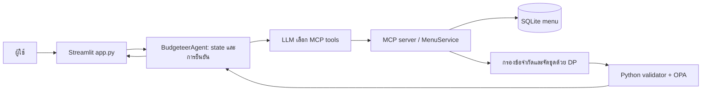

# Shiro-Jung 4.0

ผู้ช่วยวางแผนมื้อซูชิด้วย **OpenAI gpt-4o-mini + MCP + SQLite + bounded exact DP + OPA** — implementation package `4.3.0`

**แอป:** https://shiro-jung.streamlit.app/

## เริ่มตรวจโครงงาน

| เอกสาร | เนื้อหา |
|---|---|
| [README.md](README.md) | ภาพรวม ลำดับสนทนา วิธีติดตั้ง และการรัน Streamlit |
| [CODE_REVIEW.md](CODE_REVIEW.md) | หน้าที่โค้ด จุดตรวจข้อจำกัด และข้อจำกัดที่ยังเหลือ |
| [EVALUATION.md](EVALUATION.md) | วิธีประเมิน ผล offline/live/benchmark และหลักฐานที่ตรวจย้อนหลังได้ |
| [DATA_DICTIONARY.md](DATA_DICTIONARY.md) | โครงสร้างข้อมูล 42 เมนู สถานะราคา/สารก่อภูมิแพ้ และวิธียืนยันกับร้าน |

เอกสารตอบข้อประเมินรวมอยู่ใน CODE_REVIEW และ EVALUATION แล้ว ไฟล์ PowerPoint/PDF/Word จัดส่งแยก ไม่เก็บใน repository นี้ ประวัติการแก้ไขและหลักฐานรุ่นก่อนยังตรวจได้จาก Git history

## ระบบทำงานอย่างไร



1. ผู้ใช้บอกงบ จำนวนคน การแพ้ และความชอบพร้อมกัน ระบบสรุปให้ยืนยันครั้งเดียว
2. LLM เลือกเครื่องมือจากข้อมูลปัจจุบัน การเรียก `build_set` ใช้ข้อจำกัดที่บันทึกไว้ และต้อง `verify_set` ก่อนแสดงผล
3. ผู้ใช้เลือกชุด เพิ่มน้ำ/ของหวานด้วยชื่อย่อและจำนวน เช่น `น้ำส้ม 2` หรือ `วาราบิ 1` ระบบคงชุดอาหารและข้อจำกัดเดิม รวมยอดแล้วให้ยืนยันจบ
4. เปลี่ยนความชอบระหว่างสนทนาได้โดยไม่ถามงบ/การแพ้ใหม่ เมื่อจบแล้วใช้ “รีเซ็ตคำถาม” เพื่อเริ่มมื้อใหม่ การยืนยันในแอป **ไม่ส่งคำสั่งซื้อไปยังร้าน**

### เงื่อนไขที่ใช้จริง

| เงื่อนไข | การทำงาน |
|---|---|
| แพ้อาหาร | ข้อจำกัดทางการแพทย์ กรองอาหาร น้ำ และขนม; ไม่เปลี่ยนเป็นความไม่ชอบ |
| ไม่กิน/ไม่ทาน/งด/ห้าม | เป็น **hard exclusion** เสมอ มีกฎหลัง extraction แม้ LLM จัดเป็น dislike เช่น ไม่กินหมู → ตัด pork |
| ไม่ค่อยชอบ/ไม่ชอบ | เป็น soft dislike หักคะแนน ไม่สร้าง allergy หรือ hard constraint ใหม่ |
| “เนื้อ” ไม่ระบุชนิด | ถามให้เลือกหมู/วัว/ไก่/สัตว์บกทั้งหมด โดยปลา/อาหารทะเลยังเลือกได้ตามข้อจำกัดอื่น |
| ตรวจงบก่อนจัดชุด | งบรวมต้องไม่น้อยกว่า **100บาท × จำนวนคน**; เช่น50บาท/3คนเตือนให้ปรับเป็นอย่างน้อย300บาทก่อนยืนยัน คงการแพ้/ความชอบ ไม่เรียก planning/MCP จนแก้ข้อมูล |
| งบอาหารเริ่มต้น | ใช้วงเงิน 80% เพื่อเหลือเพิ่มน้ำ/ขนมภายหลัง; เป็นนโยบายหลังบ้าน ไม่แสดงตัวเลขนโยบายในแชต |
| ชุดที่สอง | ต้องไม่มีอย่างน้อย 30% ของ **ชื่อเมนูอาหารไม่ซ้ำในชุดแรก** ไม่นับน้ำ/ขนม; ถ้าทำไม่ได้เสนอชุดเดียว |
| จำนวนอาหาร | ค่า consumer ไม่เกิน 60 จาน ซ้ำไม่เกิน 3 ต่อเมนูเมื่อไม่กำหนดเพดานเอง; เมื่อผู้ใช้จำกัดจำนวนจาน ให้คะแนนก่อนยอดเงินและซ้ำไม่เกิน 2 ต่อเมนู |

**ข้อมูลเพื่อการศึกษา:** ราคา 42/42 ยัง unverified และ allergen 42/42 ยัง unknown ไม่รับรองสูตรหรือการปนเปื้อนข้าม โหมด strict จึงไม่แนะนำชุดสำหรับสั่งจริงให้ผู้แพ้เมื่อหลักฐานไม่พอ ผู้ใช้ต้องเลือก “ดูชุดจำลองจากข้อมูลเมนู” เองจึงวางแผนจากแท็กที่มีได้ โดยยังคงการแพ้และคำเตือน ผู้แพ้รุนแรงต้องให้ร้านยืนยันส่วนผสมก่อนสั่ง

## โครงสร้างสำหรับตรวจโค้ด

```text
Shiro-Jung-Agent-v4/
├── app.py                       # หน้าแชตผู้บริโภค / entrypoint ของ Cloud เดิม
├── mcp_server.py                # MCP tools, resources, prompt ผ่าน stdio
├── mcp_client_demo.py           # ทดลอง MCP จริงโดยไม่ใช้ API key
├── sushi_budgeteer/             # Agent, state, intake, planning, checkout, DP, guards
├── policies/                    # Rego policy และ tests
├── tests/ + test_smoke.py        # regression / integration / smoke
├── evaluation/                  # cases.json: offline40; sessions.json: live5sessions
├── artifacts/                   # หลักฐานปัจจุบัน 7 ไฟล์ อธิบายใน EVALUATION
├── scripts/                     # ติดตั้ง ตรวจผล ประเมิน และสร้างรายงาน
├── sushiro_menu_dataset.csv     # seed catalog; runtime อ่าน SQLite ที่สร้างจากไฟล์นี้
├── requirements.txt / requirements.lock
├── tools/opa/                   # Linux executable ที่ Cloud ใช้ + checksum + license
└── README.md / CODE_REVIEW.md / EVALUATION.md / DATA_DICTIONARY.md
```

แยกโมดูลตามหน้าที่ ไม่รวม Agent กลับเป็นไฟล์เดียว ไฟล์ทดลอง RAG/LLM terminal และผลประเมินซ้ำหลายรุ่นถูกนำออกจากชุดส่งตรวจ

## รันในเครื่อง

ใช้ **Python 3.12** รันคำสั่งจากโฟลเดอร์ `Shiro-Jung-Agent-v4`:

```bash
python -m venv .venv
# Linux/macOS: source .venv/bin/activate
# Windows PowerShell: .venv\Scripts\Activate.ps1
python -m pip install --require-hashes -r requirements.lock
python scripts/install_opa.py
python -m sushi_budgeteer.database status
```

คัดลอก `.env.example` เป็น `.env` และใส่ API key เฉพาะในไฟล์ local จากนั้น:

```bash
python -m streamlit run app.py
```

SQLite ที่ `data/menu.sqlite3` สร้างอัตโนมัติเมื่อไม่มีไฟล์ **ไม่ต้อง import ทับทุกครั้ง** หากจะแทน catalog ด้วย CSV ใหม่ให้สำรองฐานข้อมูลก่อนใช้ `python -m sushi_budgeteer.database import`

Linux มี `scripts/setup.sh` และ `scripts/start.sh` สำหรับติดตั้ง/เริ่มระบบแบบเดียวกัน ตัว OPA ที่แนบสำหรับ Linux amd64 ตรวจ checksum ก่อนใช้; macOS/Windows ใช้ `scripts/install_opa.py` ดาวน์โหลดรุ่นที่ตรงแพลตฟอร์มและตรวจ SHA256

## เงื่อนไขหลังแก้ review

- “ชอบ X” เพิ่มคะแนน ส่วน “ขอใส่ X ในชุดด้วย/ต้องมี X” ใช้ `required_keywords`: ต้องมีอย่างน้อยหนึ่งจานทุกคำที่ขอ (ยกเลิกได้ เช่น “ยกเลิกโอโทโร่”) ไม่ได้ตัดเมนูอื่นทิ้ง ต่างจาก `must_include_keywords` ที่หมายถึง “เอาเฉพาะ”
- ข้อห้าม/การแพ้มาก่อนเมนูที่ขอเสมอ ถ้าทูน่าที่ชอบเหลือแต่ของดิบและผู้ใช้ไม่ทานของดิบ จะแจ้งว่าจัดให้ไม่ได้ภายใต้ข้อห้ามเดิม ไม่ตัดทิ้งเงียบ ๆ ถ้าเป็นเมนูที่ระบุว่าต้องมี จะไม่ปล่อยชุดที่ขาดเมนูนั้น
- ข้อความเดียวมีจำนวนขั้นต่ำมากกว่าสูงสุด: เก็บงบ คน การแพ้และความชอบไว้ ถามแก้เฉพาะจำนวนจาน งบศูนย์แจ้งตรง ๆ ว่าต้องมากกว่า 0; งบเต็มต้องอย่างน้อย 100 บาท/คน
- หากผู้ใช้จำกัดจำนวนจานเอง ให้คะแนนลดซ้ำก่อนยอดเงิน และอาหารชื่อเดิมไม่เกิน 2 จาน เพื่อไม่เติมเมนูแพงซ้ำเพียงให้ถึงเป้างบ หากไม่จำกัดจาน ใช้นโยบายช่วงงบเดิม; ทั้งสองกรณีไม่เพิ่มน้ำ/ของหวานเอง
- ถามราคาเมนูระหว่างเลือกชุดจะเก็บปุ่มและรายการเดิมไว้; สั่งเบียร์จะแจ้งว่าไม่มีในเมนู
- รีเฟรชหน้าเดิมยังจำข้อมูลและตัวเลือกผ่าน SQLite ที่ `data/sessions.sqlite3` อายุ 24 ชั่วโมง เมนูที่กู้คืนต้องตรวจซ้ำกับ catalog/policy ปัจจุบัน หากเปลี่ยนจะให้จัดชุดใหม่โดยรักษาข้อมูลการแพ้ URL มี session token จึงไม่ควรแชร์ URL พร้อม `?session=...`; รีเซ็ตคำถามล้างมื้อเดิม ไม่เก็บฐานข้อมูลนี้ลง Git/ZIP

## Streamlit Cloud — คงแอปเดิม

| การตั้งค่า | ค่า |
|---|---|
| Repository | `68056056-crypto/Sushi_Budgeteer_Shiro-Jung` |
| Branch | `main` |
| Main file path | **`Shiro-Jung-Agent-v4/app.py`** |
| Python | `3.12` |
| URL | https://shiro-jung.streamlit.app/ |

ใส่เฉพาะค่าจริงใน **App settings → Secrets** ของแอปเดิม (TOML):

```toml
OPENAI_API_KEY = "ใส่คีย์จริงในหน้า Secrets เท่านั้น"
OPENAI_MODEL = "gpt-4o-mini"
```

ชื่อ URL/ตำแหน่ง entrypoint/CSV/dependencies และ OPA ที่ Cloud ใช้ยังคงเดิม ไม่เก็บ Secrets, `.env` หรือ SQLite runtime ลง Git ข้อความทางเทคนิค/trace/source tables อยู่หลังบ้าน ไม่แสดงใน UI ผู้บริโภค

## ตรวจซ้ำก่อนส่ง

```bash
python scripts/collect_evidence.py
```

คำสั่งนี้ตรวจ OPA, regression, smoke, offline40, benchmark, catalog audit และสร้าง `artifacts/report.html` สำหรับเปิดตรวจใน browser **ไม่เรียก API แบบเสียเงิน ไม่เขียนทับหลักฐาน live ที่ส่งตรวจ และไม่ import ทับ SQLite ที่มีอยู่** รายละเอียดผลและคำสั่งแยกอยู่ใน [EVALUATION.md](EVALUATION.md)

ผลปัจจุบันหลังแก้ review: **182 regression tests, 25 Rego tests, smoke61ต่อโหมด, offline40/40**; Live LLM ผ่าน 12/12 gold turns ใน 5 sessions, model-selected recommendations6, successful responses31 และ errors0 จาก [Actions run39799552734](https://github.com/68056056-crypto/Sushi_Budgeteer_Shiro-Jung/actions/runs/39799552734) ที่ source commit426b48a ซึ่งเป็น corpusก่อนเพิ่ม budget guard100บาท/คน กฎ intake, required menu, ความหลากหลายเมื่อจำกัดจาน และ persistence ปัจจุบันตรวจ offlineแล้ว ยังไม่ได้รัน liveใหม่

หากต้องการรัน live อีกครั้ง ใช้ **Actions → Live LLM evaluation → Run workflow → main**; GitHub Actions Secret ชื่อ `OPENAI_API_KEY` ใส่เฉพาะค่าคีย์หนึ่งค่า ไม่รวม `OPENAI_MODEL` มีค่าใช้จ่ายตาม API และผลใหม่เป็น artifact แยกจากหลักฐานเดิม

## ขอบเขต

เก็บบทสนทนาหลัง refresh ด้วย session token + SQLite อายุ 24 ชั่วโมง แต่ไม่รับประกันหลัง Cloud restart/redeploy และไม่มีบัญชีผู้ใช้, ไม่มีระบบบัญชีหรือการส่งออเดอร์จริง, ไม่คำนวณความอิ่ม/โภชนาการ/ภาษี/ค่าบริการ และไม่มี user satisfaction study คะแนน DP เป็น objective ของระบบ ไม่ได้พิสูจน์ว่าอร่อยหรือดีกว่าทุกวิธีทุกตัวชี้วัด ดูข้อจำกัดการทดสอบและสถานะข้อมูลตามเอกสารหลัก
