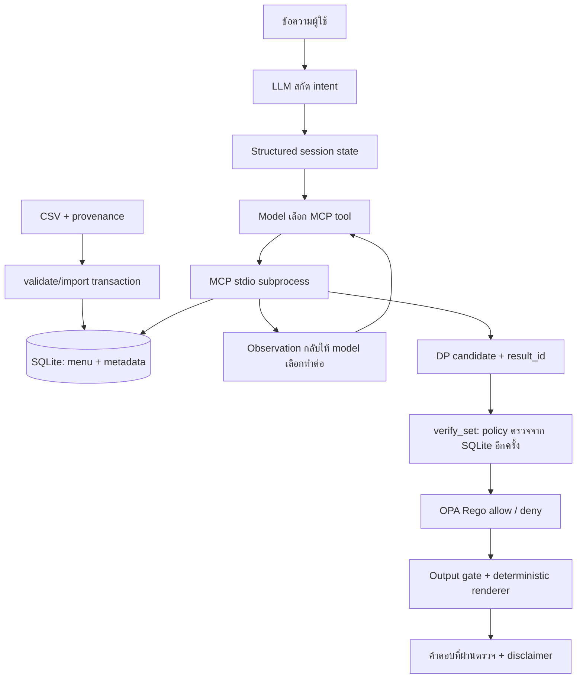

# 🍣 Shiro-Jung 4.0 — AI Agent + MCP + SQLite + OPA

ผู้ช่วยจัดชุดซูชิจาก **ฐานข้อมูล SQLite ที่นำเข้าจาก CSV จริง** มีเว็บ Streamlit และ CLI โดย Agent เลือก MCP tools อ่านผล แล้วเลือกทำต่อภายในวงจรที่จำกัดจำนวนรอบ คำแนะนำชุดอาหารจะถูกแสดงเฉพาะหลังผ่าน Python policy validator และตรวจฐานข้อมูลซ้ำก่อนตอบ

> **ข้อมูลเพื่อการศึกษา:** 42 เมนูที่แนบ (รวมน้ำเปล่า 20 บาท ราคาจากผู้ใช้) ยังไม่ได้ตรวจยืนยันราคาปัจจุบันหรือ allergen รายเมนูกับร้าน ไม่รับประกันส่วนผสมและการปนเปื้อนจริง ผู้แพ้อาหารต้องตรวจสอบกับพนักงานร้านโดยตรง

## เงื่อนไขการจัดชุดปัจจุบันสำหรับการประเมิน

หน้าเว็บใช้ **ประมาณ 80% ของงบที่ผู้ใช้แจ้ง** เพื่อเหลืออย่างน้อย 20% สำหรับการเพิ่มเครื่องดื่ม ของหวาน หรืออาหารภายหลัง ไม่พยายามใช้เงินให้หมดงบเดิม

| ตัวอย่างงบ 3,000 บาท | เงื่อนไข |
|---|---|
| วงเงินจัดชุด | ไม่เกิน 2,400 บาท คำนวณเป็นสตางค์และปัดลง |
| เงินเผื่อเปลี่ยนใจ | อย่างน้อย 600 บาท; หากจัดชุดต่ำกว่าเป้า จะเหลือมากกว่านี้ |
| ช่วงเป้าหมาย | พยายามจัดในช่วง 95–100% ของวงเงินจัดชุด หรือ 2,280–2,400 บาท (76–80% ของงบเดิม) |
| น้ำ/ขนมที่เลือกแล้ว | แบบรวมในงบ จะหักออกจาก 2,400 บาทก่อนจัดอาหาร ไม่บวกเกินวงเงินนี้ |
| ความหลากหลาย | จานแรกของแต่ละเมนูได้คะแนนเต็ม จานที่ 2 ได้ 50% และจานที่ 3 ได้ 25% เพื่อสนับสนุนเมนูไม่ซ้ำ |
| จำนวนรายการ | หากผู้ใช้ไม่กำหนด ใช้ขอบเขตสูงสุด 60 รายการแทนเพดานเดิม 20; หากระบุเอง เช่น ไม่เกิน 20 รายการ จะคงตามนั้น |
| เมนูซ้ำ | ไม่เกิน 3 จานต่ออาหารหนึ่งเมนู; จำนวนรายการรวมเครื่องดื่มและของหวานด้วย |

หากราคาและข้อจำกัดทำให้เข้าไม่ถึงช่วงเป้าหมาย ระบบเลือกยอดใกล้วงเงินจัดชุดที่สุดที่ทำได้ ไม่เกินวงเงิน ไม่เพิ่มเมนูที่แพ้หรือขัดข้อห้ามเพื่อเติมยอด และแสดงเงินที่เหลือพร้อมเหตุผลบนหน้าเว็บ ไม่มีการรับรองว่าจะใช้ได้ครบ 80% ทุกกรณี ความหลากหลายเป็นแรงจูงใจในการให้คะแนน ไม่ใช่จำนวนเมนูขั้นต่ำที่รับประกัน

เงื่อนไขการแพ้มาก่อนราคาเสมอ: “ไม่ชอบ” เป็นความชอบด้านรสชาติ ไม่ใช่การแพ้ โหมด strict จะปิดกั้นเมนูที่ข้อมูลส่วนผสมยังไม่ยืนยัน ผู้ใช้ยืนยันการแพ้ในสรุปเดียวก่อนจัดชุด การยืนยันนี้ยืนยันความต้องการของผู้ใช้ **ไม่ได้ยืนยันส่วนผสมแทนร้าน** และผู้แพ้ต้องตรวจสอบกับพนักงานก่อนรับประทาน

บทสนทนาเริ่มจากข้อมูลมื้อ → ยืนยันสรุปครั้งเดียว → เลือกได้สูงสุด 2 ชุด ก่อนยืนยันชุดสุดท้ายสามารถปรับเมนูต่อโดยใช้ข้อมูลแพ้/ชอบ/ไม่ชอบเดิม หลังยืนยันจะแสดงคำอวยพรปิดท้ายและปุ่มรีเซ็ตคำถามเพื่อเริ่มใหม่ การเลือกชุดยังไม่ใช่การส่งคำสั่งซื้อหรือชำระเงิน

กรณีผู้ใช้ยืนยันให้คิดเครื่องดื่ม/ของหวานแยกนอกงบ: เป้า 80% ใช้กับอาหาร ส่วนรายการที่เลือกจะบวกนอกวงเงินอาหาร จึงแสดงยอดจ่ายรวมแยกให้เห็น และเงินคงเหลือเมื่อเทียบงบรวมเดิมอาจน้อยกว่า 20% ภาษีและ service charge ยังไม่ได้จำลอง

## ไฟล์พร้อมใช้และขอบเขต

- `app.py`: เว็บแชต แยก Agent ต่อ Streamlit session ไม่มี cache แชร์บทสนทนา
- `sushi_budgeteer/agent.py`: model → MCP tool → observation loop พร้อม output gate
- `mcp_server.py`: MCP stdio server อ่าน SQLite; เปิด subprocess แยกต่อ client/turn
- `sushi_budgeteer/database.py`: validate/import CSV และอ่านฐานข้อมูล
- `sushi_budgeteer/optimizer.py`: exact bounded DP ด้วยมิติจำนวนและหน่วยเงินสตางค์
- `sushi_budgeteer/policy.py`: ตรวจงบ จำนวน allergen ข้อห้าม catalog revision และราคาใหม่จาก DB
- `sushi_budgeteer/service.py`: เก็บ candidate พร้อม constraint snapshot ใน server ด้วย result ID
- `sushiro_menu_dataset.csv`: ข้อมูลตั้งต้นและ provenance ไม่ใช่ข้อมูลราคาสดจากเว็บ
- `data/menu.sqlite3`: ฐานข้อมูลที่สร้างแล้วในชุด ZIP; สร้างใหม่จาก CSV ได้
- `tests/`, `scripts/`: regression tests, setup, benchmark และ demo traces
- `requirements.lock`: dependency versions พร้อม SHA256 hashes สำหรับ Python 3.12
- `mcp-config.example.json`: ตัวอย่างเชื่อม MCP client ภายนอก

**สิ่งที่ต้องเตรียมเอง:** Python 3.12, Internet สำหรับติดตั้ง dependencies และ OpenAI API key สำหรับแชตจริง ไม่มี key ก็รัน database/MCP/tests/benchmark ได้ มี OPA 1.0.1 และ Rego policy ใช้งานจริง แต่ไม่อ้างว่าได้คะแนนพิเศษหรือผ่านการทดสอบ LLM จริงแล้ว

## เริ่มเร็วที่สุด (ทุกระบบปฏิบัติการ)

หลังติดตั้ง dependencies ตามหัวข้อถัดไป ใช้คำสั่งเดียวรันหลักฐานทั้งหมดแล้วสร้างรายงาน HTML ใหม่ (ไม่ต้องใช้ bash):

```bash
python scripts/collect_evidence.py --offline   # ไม่เรียก LLM
python scripts/collect_evidence.py             # + live smoke 3 กรณี เมื่อมี key ใน .env
python scripts/collect_evidence.py --full      # + live ทุกกรณี + multi-turn 3 sessions
```

สคริปต์บังคับ UTF-8 ให้ subprocess เพื่อให้ข้อความไทยไม่พังบน Windows และถ้าไม่มี key จะบันทึกว่า skipped ไม่ใช้ผลจำลองแทน

## ติดตั้งและเริ่มใช้งาน

Linux/macOS:

```bash
cd Shiro-Jung-Agent-v4
python3.12 -m venv .venv
source .venv/bin/activate
python -m pip install --require-hashes -r requirements.lock
python scripts/install_opa.py
python -m sushi_budgeteer.database import
python scripts/run_checks.py
cp .env.example .env
# เปิด .env ด้วย editor แล้วตั้ง OPENAI_API_KEY โดยไม่แชร์หรือ commit ค่า
python -m streamlit run app.py --server.headless true --browser.gatherUsageStats false
```

Windows PowerShell:

```powershell
cd Shiro-Jung-Agent-v4
py -3.12 -m venv .venv
.\.venv\Scripts\python.exe -m pip install --require-hashes -r requirements.lock
.\.venv\Scripts\python.exe scripts/install_opa.py
.\.venv\Scripts\python.exe -m sushi_budgeteer.database import
.\.venv\Scripts\python.exe scripts/run_checks.py
Copy-Item .env.example .env
# ตั้ง key ใน .env แล้วเริ่มเว็บ
.\.venv\Scripts\python.exe -m streamlit run app.py --server.headless true --browser.gatherUsageStats false
```

ทดสอบการติดตั้งจริงบน Linux/Python 3.12.14; คำสั่ง Windows/macOS จัดไว้เป็นแนวทางและยังไม่ได้ทดสอบบนเครื่องเหล่านั้น หากต้องการ terminal chat ใช้ `python -m sushi_budgeteer` พิมพ์ `/reset` เริ่มใหม่ และ `/exit` จบ ส่วน `llm_qa.py` เป็นตัวอย่างถาม LLM ตรง ๆ ไม่ใช่ Agent จัดชุดอาหาร

`bash scripts/setup.sh` รวมขั้นตอนสร้าง venv/ติดตั้ง/import/test สำหรับ Linux/macOS; `bash scripts/start.sh` เริ่มเว็บหลัง setup คำสั่ง import จะ **แทน catalog เดิม** ด้วย CSV ให้สำรองฐานข้อมูลที่แก้เองก่อน รัน setup ซ้ำจึงเหมาะเมื่อ CSV เป็น source of truth

ใน cloud ที่เตรียมไว้แล้วใช้ `source /workspace/.venvs/sushi-release/bin/activate` และทำงานจาก `/workspace/Shiro-Jung-Agent-v4` ไม่ต้องสร้าง worktree ใหม่

## Configuration

| ตัวแปร | ค่าเริ่มต้น/หน้าที่ |
|---|---|
| `OPENAI_API_KEY` | key สำหรับ LLM; ไม่อยู่ใน ZIP |
| `SUSHI_OPENAI_API_KEY` | ชื่อสำรองสำหรับ cloud ที่สงวนชื่อ `OPENAI_`; Agent รองรับโดยตรง |
| `OPENAI_MODEL` | `gpt-4o-mini` |
| `SUSHI_DATA_MODE` | `strict` หรือ `simulation` |
| `SUSHI_DB_PATH` | default `data/menu.sqlite3`; แนะนำ absolute path เมื่อกำหนดเอง |
| `SUSHI_MENU_CSV_PATH` | ใช้เป็นไฟล์ตั้งต้นเมื่อ DB ยังไม่มี |
| `SUSHI_OPA_BINARY` | default `tools/opa/opa` หรือ `opa.exe`; หาไม่พบ/timeout จะไม่อนุญาตคำแนะนำ |

ตัวอย่าง `.env` ไม่มี key จริงและ `.gitignore` กัน `.env` แล้ว ห้ามใส่ key ใน CSV, database, trace หรือ MCP config Python dependencies ใช้ PyPI ส่วน model เรียก `api.openai.com` ซึ่งอาจมีค่าใช้จ่าย

โหมดความปลอดภัยตั้งค่าที่ backend ผ่าน `SUSHI_DATA_MODE` ไม่แสดงตัวเลือกโหมดแยกบนหน้าผู้บริโภค:

- **strict (default):** เมื่อระบุ allergen จะเลือกเฉพาะเมนูที่ `allergen_status=confirmed` และไม่ชน tag; dataset ที่แนบเป็น unknown ทั้งหมด จึงจะปิดกั้นการจัดชุดสำหรับผู้แพ้จนมีหลักฐานรายเมนู
- **simulation:** ทดลองใช้ tags จำลองใน CSV เพื่อทดสอบ/นำเสนอ ทุกคำตอบยังแสดงคำเตือน ไม่ใช่โหมดรับรองความปลอดภัย

## CSV กลายเป็นฐานข้อมูลและ MCP ดึงข้อมูลอย่างไร



```bash
python -m sushi_budgeteer.database import --csv sushiro_menu_dataset.csv
python -m sushi_budgeteer.database status
python mcp_client_demo.py
```

Importer ตรวจคอลัมน์ที่จำเป็น ID ไม่ซ้ำ ราคาไม่ติดลบ/ทศนิยมไม่เกิน 2 ตำแหน่ง และสถานะ provenance ก่อนเขียนแบบ transaction หาก CSV ไม่ผ่าน DB เดิมยังอยู่ หลัง import tools จะอ่าน `SELECT` จาก SQLite ทุกครั้ง ไม่อ่านค่าจากความจำ LLM และไม่ใช้ process-global menu cache

**CSV เป็นไฟล์นำเข้า ส่วน SQLite เป็น runtime database:** แก้ CSV แล้วต้อง import อีกครั้ง การแก้ SQLite โดยตรงมีผลต่อการค้นหาครั้งถัดไป แต่ไม่ sync กลับ CSV อัตโนมัติ เมื่อข้อมูลเปลี่ยนระหว่าง build กับ verify จะปฏิเสธ candidate revision เก่า

ดู schema และข้อกำหนดหลักฐานใน [DATA_DICTIONARY.md](DATA_DICTIONARY.md) ไม่ควรเปลี่ยน `unknown` เป็น `confirmed` เพียงเพราะพบชื่อวัตถุดิบในชื่อเมนู

## MCP tools ที่ Agent ใช้จริง

| Tool | หน้าที่ |
|---|---|
| `database_status` | อ่านจำนวนเมนู revision และสถานะข้อมูลจาก SQLite |
| `search_menu` | ค้นชื่อ/หมวด/เพดานราคา คืนข้อมูลจาก DB |
| `get_menu_item` | อ่านรายละเอียด item ID รวม provenance |
| `filter_menu` | ดูผลกรอง allergen/hard block และ dislikes/soft penalty |
| `build_set` | จัดชุดด้วย DP ตามข้อจำกัด คืน candidate หรือ requires_clarification |
| `verify_set` | รับ result ID ที่ server สร้าง ตรวจ catalog/ราคา/ยอด/ข้อจำกัดใหม่ |
| `clarify` | สร้างคำถามช่องข้อมูลที่ขาด |

Resources: `sushiro://menu/catalog`, `sushiro://menu/status`; prompt: `budget_optimizer`

Agent เรียก tools เหล่านี้ผ่าน MCP จริง ไม่ import ฟังก์ชันคำนวณมาใช้แทน MCP ผลลัพธ์แต่ละชุดมี UUID และ trusted constraint snapshot ฝั่ง server; client ส่งยอด/รายการมาอ้างว่าผ่านเองไม่ได้ result ID ใช้ได้ใน subprocess ที่สร้างมันและหมดอายุเมื่อจบ turn

สำหรับ external MCP client ให้แทน absolute paths ใน `mcp-config.example.json` ตามเครื่อง เลือก `strict` เป็นค่าเริ่มต้น แล้วให้ client เปิด `python mcp_server.py` แบบ stdio ไม่ต้องเปิด server ทิ้งไว้อีกอัน ไม่มี SSE/network endpoint ที่เปิดให้เข้าถึงโดยไม่มี authentication Client ภายนอกต้องบังคับ verify เองด้วย; output gate ที่แถมมาครอบคลุม Agent ของโครงการนี้

## ทำไมเป็น Agent และมีการตัดสินใจอะไร

ภายใน `BudgeteerAgent._run()` โมเดลเลือก tool จาก schemas ของ MCP ตามเป้าหมายและ observation ที่ได้กลับมา แล้วเลือกทำต่อหรือจบ เช่น ค้นเมนูก่อนจัดชุด ขอข้อมูลเพิ่ม หรืออ่านข้อผิดพลาดหลังจัดไม่ได้ ไม่ใช่ pipeline ที่ Python เรียก search/build ทุกตัวตามลำดับตายตัว

**ข้อกำหนดที่ Python บังคับ:** build ต้องมีข้อมูลครบ, ใช้ constraints จาก state ที่สกัดจากผู้ใช้แทน argument ที่ model อาจเปลี่ยนเอง, verify ต้องอ้าง candidate ของ turn นี้ และต้อง verify ซ้ำตอนจะส่งผลออก หากไม่ผ่านจะไม่แสดงชุดอาหาร ไม่ปล่อยข้อความคาดเดาของ LLM เป็นคำแนะนำ และไม่ stream ข้อความก่อนตรวจเสร็จ

วงจรจำกัด 10 model rounds และไม่เกิน 8 tool calls ต่อ round มี timeout ต่อการเรียก MCP และขอบเขต DP หากเกิดข้อผิดพลาดจะหยุด/ถามเพิ่ม การสกัดภาษาธรรมชาติยังขึ้นกับความถูกต้องของ LLM จึงแสดง state ใน sidebar ให้ผู้ใช้ตรวจ และยังต้องทดสอบ provider จริงก่อนใช้จริง

## เงื่อนไขและตัวอย่างการใช้งาน

ลำดับข้อมูลที่ต้องมี: **งบ → จำนวนคน → แพ้/ไม่ชอบ → ชื่อเครื่องดื่ม → จำนวน → รวม/แยกงบ → รับของหวานหรือไม่ → ชื่อและจำนวนถ้ารับ** ระบบอนุญาตให้ผู้ใช้ให้หลายช่องพร้อมกันได้ แต่จะไม่เดาข้อมูลที่ขาด เครื่องดื่มเป็นข้อกำหนดของแอปเวอร์ชันนี้ ชาเขียวร้อนฟรีเป็นตัวเลือกใน dataset

```text
ผู้ใช้: งบ 300 บาท 2 คน ชอบแซลมอน
Agent: มีอะไรที่ไม่ชอบทาน หรือแพ้อาหารประเภทไหนไหมครับ?
ผู้ใช้: ไม่มี
Agent: รับเครื่องดื่มอะไรบ้างครับ?
ผู้ใช้: ชาเขียวร้อน
Agent: ต้องการเครื่องดื่มนี้กี่แก้วครับ?
ผู้ใช้: 2 แก้ว
Agent: ต้องการให้ค่าเครื่องดื่มรวมอยู่ในงบเดิม หรือคิดแยกต่างหากดีครับ?
ผู้ใช้: รวมในงบ
Agent: รับของหวานด้วยไหมครับ?
ผู้ใช้: ไม่รับ
Agent: [เลือก build_set → อ่าน candidate → verify_set → ตอบรายการจาก DB]
ผู้ใช้: เพิ่มงบอีก 100 บาท
Agent: [จำข้อจำกัดเดิม ใช้งบ 400 และตรวจชุดใหม่]
```

ตัวอย่างนี้เป็นสถานการณ์ที่ออกแบบไว้ ไม่ใช่ transcript จาก OpenAI ที่ผ่านการทดสอบแล้ว หากแพ้กุ้งใน strict mode และยังไม่มีหลักฐานรายเมนู ระบบจะไม่เสนอชุดโดยอาศัยการเดา ต้องเพิ่มหลักฐานหรือเลือก simulation เพื่อการสาธิตเท่านั้น ไม่ควรชักชวนผู้แพ้ให้ใช้ simulation เพื่อรับประทานจริง

| ความหมาย | Field | กฎ |
|---|---|---|
| แพ้กุ้ง | `allergens=["crustacean"]` | hard exclusion จาก tags; unknown ถูกบล็อกใน strict |
| ไม่ชอบหอย | `dislikes` | หักคะแนน 3 ยังอาจเลือกได้ |
| ห้ามมีของดิบ | `hard_exclude_keywords` | ตัดออกด้วย text matching ทุกส่วนของชุด |
| ชอบแซลมอน | `preferred_keywords` | เพิ่มคะแนน ไม่บังคับต้องมี |
| กินเฉพาะกุ้งกับปลา | `must_include_keywords` | อาหารหลักแต่ละเมนูต้องตรงอย่างน้อยหนึ่งคำ; ไม่บังคับให้มีทั้งสองชนิด เครื่องดื่ม/ของหวานที่เลือกเองแยกกฎนี้ |

งบต้องมากกว่า 0 และไม่เกิน 100,000 บาท ทศนิยมไม่เกิน 2 ตำแหน่ง จำนวนคน/รายการสูงสุด 60 รายการ จำนวน min/max **นับรวมอาหาร เครื่องดื่ม ของหวาน** และต้องมีอาหารหลักอย่างน้อย 1 จาน หากเลือกคิดแยก งบครอบคลุมเฉพาะอาหาร แต่จะรายงานยอดจ่ายรวมเครื่องดื่ม/ของหวานชัดเจน ภาษีและ service charge ยังไม่ได้จำลอง

State เก็บงบและข้อจำกัดข้าม turn พร้อมประวัติช่วงล่าสุด แต่ยังไม่บันทึกบทสนทนาลง disk การแพ้/ข้อห้าม/ความชอบส่วนใหญ่สะสม การส่งรายการว่างไม่ล้างค่า ใช้ปุ่มรีเซ็ตเริ่มชุดเงื่อนไขใหม่ ไม่แชร์ Agent กับผู้ใช้อื่น จำนวนคนยังไม่ได้แปลงเป็นโภชนาการหรือปริมาณอิ่มต่อคน

## Optimization และ verification

เป้าหมายจัดชุดใช้ **วงเงิน 80% ของงบเดิม** (`spend_ratio=0.8` จากหน้าเว็บ) แล้วหักเครื่องดื่ม/ของหวานที่รวมในงบออกก่อน ภายในงบอาหารที่เหลือ เลือกชุดในช่วง 95–100% ของงบอาหารโดยเรียงคะแนนความชอบหลังลดคะแนนเมนูซ้ำก่อน แล้วใช้ยอดเงินจริงเป็นตัวตัดสินเมื่อคะแนนเท่ากัน หากไม่มีชุดในช่วงนั้น ให้เรียงยอดใกล้งบอาหารที่สุดก่อนคะแนน ทั้งหมดอยู่ภายใต้ช่วงจำนวนรายการและอาหารซ้ำไม่เกิน 3 จานต่อเมนู ใช้ state `(count, cost_satang)` และ immutable backtracking จึงไม่ทิ้งทางเลือกเพราะจำนวนจานต่างกัน มี state limit 250,000 เพื่อให้การทำงานจำกัดทรัพยากร หากเกิน limit จะรายงานให้ลดขนาด ไม่เปลี่ยนไปสุ่มแนะนำ

```text
score = preference + price_score + category_bonus - dislike_penalty (ต่ำสุด 0)
preference: 2.5 ต่อ preferred keyword ที่ตรง สูงสุด 5
price_score: ราคา 35–80 = 3, ราคาอื่น <=100 = 2, ราคา >100 = 1
category_bonus: ไม่ใช่หมวดปลาดิบ = 2, ปลาดิบ = 0
penalty: ตรง dislike = 3
```

เครื่องดื่ม/ของหวานเลือกตามชื่อและจำนวนที่ยืนยันก่อน แล้วหักวงเงินจัดชุดเมื่อเลือกแบบรวม ความหลากหลายสนับสนุนผ่านคะแนนส่วนเพิ่มที่ลดลงตามจำนวนจานซ้ำ (1, 0.5, 0.25 เท่าของคะแนนพื้นฐาน) และรายงานจำนวนเมนูไม่ซ้ำ ไม่ใช่การบังคับครบทุกหมวด ไม่ใช่คะแนนโภชนาการหรือคุณภาพจริง

Validator คำนวณราคา × จำนวนจาก catalog จริง ตรวจ ID, quantity, ยอดรวม, งบตาม mode, จำนวนขั้นต่ำ/สูงสุด, อาหารอย่างน้อยหนึ่งจาน, repeat cap, allergen, hard exclusions, only-food constraint และ catalog revision ผลที่ไม่ผ่านไม่ถูกนำไปแสดงเป็นคำแนะนำ จำนวนเครื่องดื่ม/ของหวานที่ขอจะถูกตรวจด้วย

การเรียก library `dp_knapsack` แบบเดิมยังมี `objective="score"` เป็นค่าเริ่มต้นเพื่อคง baseline สำหรับการวิเคราะห์ ส่วน `build_optimal_set` ใช้ `objective="budget", diversity=True` และหน้าเว็บส่ง `spend_ratio=0.8` ทุกครั้ง MCP/direct tools มีค่าเริ่มต้น `spend_ratio=1.0` สำหรับผู้เรียกเดิม จึงต้องระบุ 0.8 เมื่อต้องการจำลองเงื่อนไขเว็บ

Benchmark ที่บันทึกไว้เป็น **baseline เดิมแบบ score-first ไม่ใช่ผลประเมินเงื่อนไขสำรองงบ 80% เวอร์ชันนี้** เปรียบเทียบ **DP, greedy density, greedy score, random** บนข้อจำกัดเดียวกัน 12 สถานการณ์ และ random 100 seeds ต่อสถานการณ์ รวม 1,200 runs รายงาน score, spend, budget utilization, diversity และ runtime แยกกัน ค่าเฉลี่ย DP score = **33.333** และ random mean = **21.4825** ในชุดนี้ ไม่ใช่ผลคุณภาพ LLM ความพึงพอใจ หรือข้อพิสูจน์กับข้อมูลร้านจริง ดู `python scripts/benchmark.py` และ artifact รายกรณี

## ทดสอบและ artifacts

```bash
python scripts/collect_evidence.py --offline   # หรือรันทีละขั้นด้านล่าง
python scripts/run_checks.py
python mcp_client_demo.py
python scripts/benchmark.py
python scripts/capture_demo.py
python scripts/evaluate.py --mode offline
python scripts/evaluate.py --mode live --limit 3
python scripts/live_sessions.py
python scripts/build_report.py
```

ผลตรวจในชุดนี้:

- Regression/integration **45 tests** รวม DP เทียบ exhaustive search 35 fixtures, ทศนิยม, tampering, session isolation, unknown allergen, strict/simulation, DB เปลี่ยน, Agent gate และ Streamlit page
- OPA/Rego **15 tests** ตรวจ allow/deny แยกจาก Python
- Evaluation **40 กรณี** ผ่าน MCP/SQLite/OPA จริง โดยไม่เรียก LLM; แยกจาก regression tests
- Legacy smoke **61 checks** ใน simulation mode
- MCP ทดสอบ subprocess จริง และเปลี่ยนราคาใน SQLite แล้วอ่านผ่าน MCP เพื่อพิสูจน์การดึงข้อมูลจริง
- ติดตั้งจาก lockfile พร้อมตรวจ hashes ใน venv ใหม่บน Linux/Python 3.12 ผ่าน
- Agent tests ใช้ **scripted fake model + MCP/SQLite จริง** ยังไม่ได้เรียก OpenAI จริงเพราะไม่มี API key

Artifacts: `artifacts/validation-report.json`, `artifacts/opa-tests.json`, `artifacts/offline-evaluation.json`, `artifacts/live-evaluation.json`, `artifacts/live-sessions.json`, `artifacts/demo-traces.json`, `artifacts/benchmark.json` และ `artifacts/presentation-report.html` ซึ่งเปิดเป็นไฟล์ HTML บนเครื่องเพื่อดูตาราง/กราฟและกรองผลได้

Trace ระบุ model source, session/turn ID, tools ที่เลือก, arguments, observation status, OPA decision, latency และ token counts จาก provider โดยไม่บันทึก prompt/chain-of-thought/API key ผล `scripted` ไม่ใช่หลักฐาน LLM จริง หาก provider ไม่รายงาน usage จะระบุว่าไม่ครบและไม่ตีค่าใช้จ่ายเป็นศูนย์ Cost ใน live evaluation คำนวณเมื่อผู้ใช้ระบุ rate ที่ต้องการเองเท่านั้น เป็นประมาณการที่ยังไม่แยก cached token discounts

กฎสัดส่วน 80% เป็นการทำงานหลังบ้าน: หน้าแชตและสรุปยืนยันไม่แสดงข้อความ “จัดชุดใกล้ 80%” หรือเปอร์เซ็นต์การใช้งบ แสดงเฉพาะงบ ยอดใช้จริง และยอดคงเหลือ เอกสารนี้ยังอธิบายสูตรเพื่อการตรวจประเมิน

เมื่อพิมพ์ “เมนูของหวาน” หรือ “เมนูน้ำ” ระบบอ่านรายการและราคาจาก catalog โดยตรง พร้อมช่องเลือกเมนูและจำนวน ไม่ถามชื่อซ้ำ การเลือกจะ **แทนรายการเดิมในหมวดนั้น** ตามข้อความที่แสดงก่อนกด จากนั้นจัดชุดและตรวจราคา/การแพ้ใหม่ ถ้าข้อมูลส่วนผสมไม่เพียงพอใน strict จะไม่ให้เลือกเมนูนั้น

หลังเลือกชุดสุดท้าย ระบบแสดง “ขอให้เป็นมื้ออาหารที่อร่อยครับ … กดรีเซ็ตคำถามเพื่อเริ่มการสนทนาใหม่” ปิดช่องแชตและตัวเลือกเดิม จนกดรีเซ็ต ซึ่งล้างข้อมูลมื้อเดิมทั้งหมด ยังไม่มีการส่งคำสั่งซื้อหรือชำระเงินไปยังร้านจริง

หน้าเว็บสำหรับผู้บริโภคแสดงรายการอาหาร จำนวน ราคา และชุดทางเลือกได้สูงสุด 2 ชุด โดยไม่แสดงตารางหลักฐาน คะแนน ชื่อเทคโนโลยี หรือ trace รายละเอียดการตรวจสอบยังอยู่ใน backend (`agent.run_report()` และผลที่ service เก็บ) ทุกชุดต้องผ่านการตรวจเดิมก่อนแสดง

เมื่อเลือกชุดด้วยปุ่มหรือพิมพ์ `1`/`2` ระบบตรวจข้อมูลเมนูล่าสุดซ้ำแล้วสรุปชุดให้ ยังไม่ส่งคำสั่งซื้อหรือชำระเงิน ข้อความต่อเนื่อง เช่น “อยากกินเซลมอน” จะปรับชุดโดยใช้ข้อมูลเดิม รวมงบ จำนวนคน การแพ้ ความชอบ ไม่ชอบ และเครื่องดื่ม การเริ่มมื้อบนเว็บจะรวมข้อมูลเป็นสรุปครั้งเดียว ให้เลือกยืนยันหรือแก้ไข ไม่มีคำถามเครื่องดื่ม/ของหวานไล่ทีละข้อ หากยังไม่เลือกเครื่องดื่มจะไม่เพิ่มให้ ของหวานเริ่มต้นเป็นไม่รับ และค่าเครื่องดื่ม/ของหวานรวมในงบ ทั้งหมดแสดงก่อนยืนยัน หากเลือกเครื่องดื่มแต่ยังไม่บอกจำนวน สรุปจะเสนอเท่าจำนวนคนเพื่อให้ยืนยัน เปลี่ยนข้อมูลเหล่านี้ได้ด้วยแชต

คำว่า “ไม่ชอบปลาหมึก” ไม่สร้างการแพ้ หากเคยบันทึกผิด ผู้ใช้แจ้ง “ไม่ได้แพ้ แค่ไม่ชอบปลาหมึก” แล้วตรวจสรุปและกดยืนยันเพื่อแก้เฉพาะสารที่ระบุ การแพ้อื่นยังคงอยู่

ผู้แพ้อาหารจะเห็นคำเตือนเสมอ Strict ยังคงปิดกั้นเมนูที่ไม่มีหลักฐานส่วนผสมยืนยัน ส่วนชุดทดลองกรองสารก่อภูมิแพ้ตาม tags ที่มี แต่ไม่รับรองส่วนผสมจริงหรือการปนเปื้อนข้าม หากเงื่อนไขทำให้มีชุดที่เป็นไปได้เพียงชุดเดียว ระบบแสดงชุดเดียวและแจ้งผู้ใช้ ไม่สร้างตัวเลือกที่ขัดข้อจำกัด

## แหล่งข้อมูล ราคา และสารก่อภูมิแพ้

- [เอกสาร P450.pdf จากกองอาหาร อย.](https://food.fda.moph.go.th/media.php?id=654869394207416320&name=P450.pdf) — แหล่งที่ผู้ใช้ให้สำหรับตรวจเกณฑ์ allergen; ไม่ใช่หลักฐานส่วนผสมของเมนูร้าน

การเข้าถึง PDF จาก cloud ได้ HTTP 403 ในการตรวจครั้งก่อน จึงยังไม่รับรองเนื้อหา PDF ส่วนราคาใน dataset ยังไม่ยืนยันกับร้าน และไม่มีการสร้าง tag จากการเดาชื่ออาหาร แยก **เอกสารเกณฑ์ → vocabulary** จาก **หลักฐานร้านรายเมนู → allergen_status** อย่างชัดเจน ควรอ่านฉบับเต็มพร้อมฉบับแก้ไขก่อนอ้างขอบเขตกฎหมาย

## Harness, OPA และงานนำเสนอ

OPA ใช้งานจริงผ่าน CLI ใน `sushi_budgeteer/opa.py` กับ `policies/recommendation.rego` Python คำนวณ trusted facts จาก SQLite และ constraints ที่ server เก็บไว้ แล้วบังคับ **Python ผ่าน AND OPA allow** ก่อนส่งชุดอาหาร ค่า `verified=true` จาก model ไม่ถูกใช้เป็นใบอนุญาต ถ้าขาด executable, policy ผิด, timeout หรือผลอ่านไม่ได้ จะ fail closed มี Rego tests ที่พิสูจน์ว่า OPA ตรวจ over-budget/allergen/ราคาผิดได้เอง แม้ลบ Python issues ออกจาก input ทดสอบ

ZIP แนบ Linux amd64 static binary ของ OPA 1.0.1, checksum และ Apache license จากต้นทาง `scripts/install_opa.py` ตรวจ SHA256 ของ binary และคืน executable permission หลังแตก ZIP; บนแพลตฟอร์มอื่นดาวน์โหลด asset ทางการพร้อม checksum ไม่มีการปิด TLS/hash verification

อ่าน [EVALUATION.md](EVALUATION.md) สำหรับ live runners, การอ่าน metrics และแผนสาธิต 3 นาที ปัจจุบันรายงาน live เป็น **blocked_missing_credentials (0 calls)** จนกว่าจะตั้ง key อย่างปลอดภัย ห้ามใช้ traces จำลองแทนหลักฐาน LLM จริง และ OPA ไม่ได้แทน optimizer หรือรับรองความถูกต้องของข้อมูลร้าน

เอกสารเพิ่มเติม: [CODE_REVIEW.md](CODE_REVIEW.md), [DATA_DICTIONARY.md](DATA_DICTIONARY.md), [EVALUATION.md](EVALUATION.md), [OPA documentation](https://www.openpolicyagent.org/docs), [Streamlit cache scope](https://docs.streamlit.io/develop/api-reference/caching-and-state/st.cache_resource)

`rag.py` และ `requirements-rag.txt` เป็นส่วนทดลองเสริม ไม่อยู่ใน MCP tools ของ release นี้ การจัดชุดทุกเส้นทางหลักใช้ shared builder; ไม่ต้องติดตั้ง FAISS เพื่อใช้ Agent/MCP/SQLite และไม่อ้างว่า RAG ผ่านการทดสอบ live แล้ว
